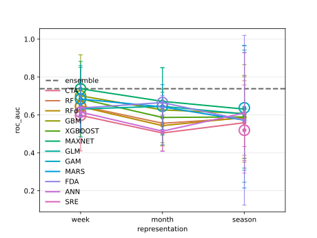

<!-- Python blocks run by tools/python_twins.py (md5 c554e1d5375488b1e12a09f5f55bcfd8). -->

```{r setup, include = FALSE}
knitr::opts_chunk$set(collapse = TRUE, comment = "#>", fig.width = 6.5, fig.height = 4.5,
                      dev.args = list(pointsize = 14))
library(timesift)
if (nzchar(Sys.getenv("TIMESIFT_DOCS_CACHE"))) source(Sys.getenv("TIMESIFT_DOCS_CACHE"))
```

biomod2 fits several species distribution algorithms to one table of predictors and combines their
predictions. When the predictors come from a sensor record, such as hourly soil temperature or daily
air temperature, that table is already a summary of the record, for example monthly means or
growing-degree-days. `timesift` fits the same algorithms to the record summarised at every temporal
grain it supports, scores all of them on the same held-out folds, and then combines them.

R and Python use a shared compiled implementation of each algorithm. Tests compare its output with the reference packages used by biomod2: rpart, randomForest, gbm, xgboost, maxnet, MASS, earth, mda, mgcv and nnet. These packages serve as test references; timesift fits models using its own implementations.

## Installation

::: {.lang-pair}
```{r, eval = FALSE}
# Install from CRAN
install.packages("timesift")

# Or install the development version from GitHub
# install.packages("pak")
pak::pak("gcol33/timesift")
```

```bash
# Install from PyPI
pip install timesift

# with the torch encoders, the contrasts and the plots
pip install "timesift[torch,contrasts,plot]"

# Or install the development version from GitHub
pip install git+https://github.com/gcol33/timesift
```
:::

## The mapping

Each biomod2 algorithm corresponds to a learner constructor, and a variant of an algorithm is an
argument of that constructor.

| biomod2 | `timesift` | notes |
|---|---|---|
| `CTA` | `tree()` | rpart's rules; `prune = "se_sum"` is biomod2's pruning |
| `RF` | `forest()` | randomForest's defaults |
| `RFd` | `forest(balance = TRUE)` | each tree draws as many units from each class as the smaller class holds |
| `GBM` | `boosting()` | gbm's trees and Newton step |
| `XGBOOST` | `boosting(method = "xgboost")` | xgboost's exact greedy trees; `lambda` and `gamma` are its penalties |
| `MAXNET`, `MAXENT` | `maxent()` | `classes`, `regmult` and `knots` are maxnet's; the model is the background formulation by default |
| `GLM` | `linear()` | `y ~ x + I(x^2)` over every column, searched by AIC as `MASS::stepAIC()` does |
| `GAM` | `additive()` | mgcv's `gam(method = "GCV.Cp")`, `k = 10` |
| `MARS` | `mars()` | earth's forward and pruning passes, refitted as a logistic model |
| `FDA` | `discriminant()` | mda's `fda(method = mars)` with the probit recalibration biomod2 applies |
| `SRE` | `envelope()` | `quantile = 0.025`, as `bm_SRE()` |
| `ANN` | `perceptron()` | nnet's network of one hidden layer, fitted by nnet's BFGS |
| `DNN` | `mlp()` | cito's optimiser, penalty and schedule are `train_control()` settings |

`perceptron()` is nnet's model and nnet's fit: one layer of logistic hidden units, fitted by the
variable metric (BFGS) method nnet uses, and from the same starting weights it ends at the same
weights. It differs from biomod2's `ANN` in two respects. biomod2 leaves nnet's `entropy = FALSE`,
which fits a presence-absence response by least squares on the logistic output; `perceptron()` fits
the cross-entropy, because every learner fits the loss of the response head. The starting weights
are drawn from the package's own generator rather than from R's. biomod2 sets two hidden units,
which is the default, and `preset = "bigboss"` gives its tuned `size = 5`, `decay = 0.1`,
`rang = 0.1` and `maxit = 200`. Neither nnet nor `perceptron()` scales the columns, so a record
read in its own units, such as degrees, saturates the hidden units sooner the wider its range.

biomod2's `DNN` is cito's `dnn()`, a fully connected network trained by a stochastic optimiser.
`mlp()` builds the same network from `hidden`, `activation` and `dropout`, and `train_control()`
holds cito's training settings: `optimizer`, `learning_rate`, `penalty` and `alpha` for cito's
`lambda` and `alpha`, and `schedule`. cito's `alpha` weighs the norm of the weights and
`train_control()`'s weighs their absolute values, as `elasticnet()`'s does, so one is one minus the
other. Any of these settings can be given to `mlp()` directly. biomod2's default `DNN` is cito's
defaults,

::: {.lang-pair}
```{r dnn-default, eval = FALSE}
mlp(hidden = c(50L, 50L), activation = "selu", dropout = 0, optimizer = "sgd",
    learning_rate = 0.01, weight_decay = 0, schedule = "constant", epochs = 100L)
```

```python
import timesift as ts

ts.mlp(hidden=(50, 50), activation="selu", dropout=0, optimizer="sgd",
       learning_rate=0.01, weight_decay=0, schedule="constant", epochs=100);
```
:::

and its tuned `DNN` is

::: {.lang-pair}
```{r dnn-bigboss, eval = FALSE}
mlp(hidden = c(100L, 100L), activation = "selu", dropout = 0,
    optimizer = "adam", learning_rate = 0.05, weight_decay = 0,
    penalty = 0.001, alpha = 0, schedule = "plateau", plateau_patience = 7L,
    epochs = 150L, batch_size = 100L, val_frac = 0.2, early_stopping = 14L)
```

```python
ts.mlp(hidden=(100, 100), activation="selu", dropout=0,
       optimizer="adam", learning_rate=0.05, weight_decay=0,
       penalty=0.001, alpha=0, schedule="plateau", plateau_patience=7,
       epochs=150, batch_size=100, val_frac=0.2, early_stopping=14);
```
:::

Three differences remain. cito's default batch is a tenth of the fitting rows, where `batch_size`
counts rows. biomod2 standardises each column for `DNN`, where `mlp()` standardises each channel
across its bins. The tuned set ends a fit whose training loss is still above an intercept-only
model's after 30 epochs (cito's `burnin`), which `mlp()` does not do.

biomod2 ships two option sets: its defaults and a tuned set called `"bigboss"`. Where the two
differ, the learners offer both, as `preset = "default"` (the defaults of the fitting package, which
biomod2's default set uses) and `preset = "bigboss"`. For example, `tree(preset = "bigboss")` sets
`min_split = 5`, `min_leaf = 5`, `cp = 0.001`, `max_depth = 10` and five inner folds. A setting
given explicitly overrides either preset. `mars()`, `discriminant()` and `additive()` have a single
set, because biomod2 uses the same settings for them in both.

## One run

The example uses a simulated record: 200 units with readings every six hours for a year, and three
responses that depend on the record through a lagged mechanism acting at weekly grain. Because the
simulation puts the signal at the week, the comparison below can be checked against it.

::: {.lang-pair}
```{r data}
sim <- simulate_records(n = 200L, mechanism = "lag", variables = 3L, days = 365L,
                        step_hours = 6, prevalence = 0.25, auc = 0.85, seed = 4L)
targets <- data.frame(unit = rownames(sim$y), sim$y)
str(sim$readings)
```

```python
import pandas as pd

sim = ts.simulate_records(n=200, mechanism="lag", variables=3, days=365,
                          step_hours=6, prevalence=0.25, auc=0.85, seed=4)
targets = pd.DataFrame(sim.y.values, columns=sim.y.variables)
targets.insert(0, "unit", sim.y.units)
readings = pd.DataFrame(sim.readings)
readings.dtypes
#> unit                 str
#> time       datetime64[s]
#> reading          float64
#> dtype: object
```
:::

`models` is a named list, so each candidate is reported under its biomod2 name. A learner without a
`data =` argument runs at every grain listed in `sift`; a learner with `data =` runs only at that
representation.

::: {.lang-py-only}
In Python a learner carries its own name, and `dataclasses.replace(learner, name="CTA")` gives a candidate the name biomod2 uses.
:::

::: {.lang-pair}
```{r models}
models <- list(
  CTA = tree(),
  RF = forest(),
  RFd = forest(balance = TRUE),
  GBM = boosting(),
  XGBOOST = boosting(method = "xgboost"),
  MAXNET = maxent(),
  GLM = linear(),
  GAM = additive(data = grain("season"), k = 5L),
  MARS = mars(),
  FDA = discriminant(),
  ANN = perceptron(),
  SRE = envelope(data = grain("season"))
)
```

```python
from dataclasses import replace

models = {
    "CTA": ts.tree(),
    "RF": ts.forest(),
    "RFd": ts.forest(balance=True),
    "GBM": ts.boosting(),
    "XGBOOST": ts.boosting(method="xgboost"),
    "MAXNET": ts.maxent(),
    "GLM": ts.linear(),
    "GAM": ts.additive(data=ts.grain("season"), k=5),
    "MARS": ts.mars(),
    "FDA": ts.discriminant(),
    "ANN": ts.perceptron(),
    "SRE": ts.envelope(data=ts.grain("season")),
}
learners = [replace(m, name=name) for name, m in models.items()]
```
:::

Two learners are fixed to the seasonal grain. An additive model fits `k - 1` coefficients per
column. At weekly grain this record has 53 columns, which would need 478 coefficients for 160
training units, and `additive()` refuses such a fit; the four seasonal columns need 17. The envelope
excludes one presence in twenty at each end of every column, so each added column leaves fewer units
inside all the bands, and the envelope is suited to a coarse grain.

::: {.lang-pair}
```{r fit}
fit <- timesift(
  targets, sim$readings,
  y = starts_with("v"), id = unit, time = time,
  learners = models,
  sift = grains("week", "month", "season"),
  ensemble = ensemble("weighted", decay = 1.6, min_score = 0.5),
  resampling = cv(v = 5),
  verbose = FALSE
)
fit$candidates[c("candidate", "grain", "bins", "status")][1:6, ]
```

```python
fit = ts.timesift(
    targets, readings,
    y="v*", id="unit", time="time",
    learners=learners,
    sift=ts.grains("week", "month", "season"),
    ensemble=ts.ensemble("weighted", decay=1.6, min_score=0.5),
    resampling=ts.cv(v=5),
    verbose=False,
)
pd.DataFrame(fit.candidates)[["candidate", "grain", "bins", "reason"]].head(6)
#>       candidate   grain  bins reason
#> 0    CTA / week    week    53
#> 1   CTA / month   month    12
#> 2  CTA / season  season     5
#> 3     RF / week    week    53
#> 4    RF / month   month    12
#> 5   RF / season  season     5
```
:::

The run fitted 32 candidates: ten learners at three grains each and the two fixed learners at one.
All of them were cross-validated on the same five outer folds and scored on the same cells, so their
mean scores are directly comparable.

::: {.lang-pair}
```{r scores}
fit
```

```python
fit
#> timesift  200 targets, 3 responses, 5-fold random CV, roc_auc
#>
#> candidates, scored on the outer folds
#> candidate                  mean    won  responses
#> CTA / month               0.505      0  separate
#> ANN / month               0.515      0  separate
#> SRE / season              0.520      0  separate
#> RFd / month               0.544      0  separate
#> RF / month                0.556      0  separate
#> CTA / season              0.559      0  separate
#> MARS / season             0.572      0  separate
#> FDA / season              0.573      0  separate
#> RF / season               0.584      0  separate
#> RFd / season              0.587      0  separate
#> XGBOOST / month           0.587      0  separate
#> XGBOOST / season          0.590      0  separate
#> CTA / week                0.598      0  separate
#> GLM / season              0.605      0  separate
#> GBM / season              0.608      0  separate
#> ANN / season              0.611      0  separate
#> ANN / week                0.615      0  separate
#> GBM / month               0.627      0  separate
#> MAXNET / season           0.631      0  separate
#> GLM / week                0.632      0  separate
#> FDA / week                0.637      0  separate
#> GAM / season              0.638      0  separate
#> MARS / month              0.643      0  separate
#> RFd / week                0.644      0  separate
#> GLM / month               0.646      0  separate
#> RF / week                 0.648      0  separate
#> FDA / month               0.666      0  separate
#> MAXNET / month            0.672      0  separate
#> MARS / week               0.684      0  separate
#> XGBOOST / week            0.686      0  separate
#> GBM / week                0.701      0  separate
#> MAXNET / week             0.738      3  separate
#>
#> procedure, chosen and weighted inside each outer training fold
#> selected                  0.738  se 0.034
#> ensemble                  0.739  se 0.035
#> selected MAXNET / week in 5 of 5 folds
#>
#> choice on every target  MAXNET / week
#> weights on every target  MAXNET / week 0.38   GBM / week 0.23   XGBOOST / week 0.15   MARS / week 0.09   MAXNET / month 0.06   FDA / month 0.04   RF / week 0.02   GLM / month 0.01   RFd / week 0.01   MARS / month 0.01
```
:::

The report gives the AUC of each candidate, the number of responses on which it scored highest, and
the held-out scores of the selection procedure and of the weighted ensemble. The [four]{.lang-r-only}[four]{.lang-py-only py="['zero', 'one', 'two', 'three', 'four', 'five', 'six', 'seven', 'eight'][
next((i for i, r in enumerate(sorted((r for r in ts.candidate_table(fit) if r['mean'] is not None),
key=lambda r: -r['mean'])) if not r['candidate'].endswith(' / week')), 0)]"} highest mean
AUCs belong to weekly candidates, the grain at which the simulation places the signal. A biomod2 run
shows which algorithm performs best on one table. Here the run also gives the grain at which each
algorithm does best, and the ranking of grains within one algorithm need not match the ranking of
algorithms.

::: {.lang-pair}
```{r plot-fit, fig.alt = "Mean AUC of each candidate against the representation it read."}
plot(fit)
```

```{.python fig-alt="Mean AUC of each candidate against the representation it read."}
ts.plot(fit);
```


:::

## Side by side

A biomod2 run formats the data, fits the algorithms under a cross-validation strategy and then
builds the ensembles. The two calls below set up the same run in each package: biomod2 on a table of
predictors, `timesift` on a record.

::: {.lang-r-only}
Neither chunk is evaluated.
:::

::: {.lang-py-only}
The biomod2 chunk is not evaluated. The `timesift` call runs on the record above.
:::

```{r biomod2-side, eval = FALSE}
fmt <- BIOMOD_FormatingData(resp.var = y, expl.var = predictors,
                            resp.xy = xy, resp.name = "sp1")
mod <- BIOMOD_Modeling(fmt, modeling.id = "all",
                       models = c("CTA", "RF", "GBM", "XGBOOST", "MAXNET", "GLM",
                                  "GAM", "MARS", "FDA", "ANN", "SRE"),
                       CV.strategy = "kfold", CV.nb.rep = 1, CV.k = 5,
                       metric.eval = c("TSS", "ROC"))
ens <- BIOMOD_EnsembleModeling(mod, models.chosen = "all",
                               em.algo = c("EMmean", "EMwmean", "EMca"),
                               metric.select = "TSS", metric.select.thresh = 0.5,
                               metric.eval = c("TSS", "ROC"))
```

::: {.lang-pair}
```{r timesift-side, eval = FALSE}
fit <- timesift(targets, series, y = starts_with("sp"), id = plot_id, time = datetime,
                learners = list(CTA = tree(), RF = forest(), GBM = boosting(),
                              XGBOOST = boosting(method = "xgboost"), MAXNET = maxent(),
                              GLM = linear(),
                              MARS = mars(), FDA = discriminant(), ANN = perceptron()),
                sift = grains("week", "month", "season"),
                ensemble = ensemble("weighted", min_score = 0.5),
                resampling = cv(v = 5))
```

```python
fit_side = ts.timesift(targets, readings, y="v*", id="unit", time="time",
                       learners=[m for m in learners if m.name in
                                 ("CTA", "RF", "GBM", "XGBOOST", "MAXNET", "GLM",
                                  "MARS", "FDA", "ANN")],
                       sift=ts.grains("week", "month", "season"),
                       ensemble=ts.ensemble("weighted", min_score=0.5),
                       resampling=ts.cv(v=5), verbose=False);
```
:::

biomod2 fits one species per call. In `timesift`, `y` selects all response columns at once, and the
responses share one fold map, one set of scorable cells and one set of candidates. Each response is
a column of the result.

## Ensembling

biomod2's ensemble algorithms are options of `ensemble()`:

| biomod2 | `timesift` |
|---|---|
| `EMmean` | `ensemble("mean")` |
| `EMmedian` | `ensemble("median")` |
| `EMwmean` | `ensemble("weighted")`; `decay =` is `EMwmean.decay` |
| `EMca` | `ensemble("committee")`; `rule =` picks how each member's cut is learned |
| `EMcv`, `EMci` | `predict(type = "spread")` |
| `metric.select`, `metric.select.thresh` | `metric =`, `min_score =` |
| none | `ensemble("stack")` |

The stack is `timesift`'s default. It fits non-negative weights that sum to one, using only the
out-of-fold predictions, and minimises the loss of the response head over the scorable cells. No
weight is therefore fitted on a prediction a member made for a unit it was trained on.

`min_score = 0.5` excluded any candidate whose mean AUC was below 0.5, the role
`metric.select.thresh` plays in biomod2. The six largest weights in this run:

::: {.lang-pair}
```{r weights}
round(sort(fit$weights, decreasing = TRUE)[1:6], 3)
```

```python
pd.Series(ts.ensemble_weights(fit)).sort_values(ascending=False).head(6).round(3)
#> MAXNET / week     0.375
#> GBM / week        0.234
#> XGBOOST / week    0.146
#> MARS / week       0.092
#> MAXNET / month    0.057
#> FDA / month       0.036
#> dtype: float64
```
:::

Committee averaging converts each member's predictions to presence or absence at a threshold learned
from that member's out-of-fold predictions, then averages these votes. A smaller run at one grain:

::: {.lang-pair}
```{r committee}
fit_ca <- timesift(
  targets, sim$readings,
  y = starts_with("v"), id = unit, time = time,
  learners = models[c("RF", "GBM", "MAXNET", "MARS", "FDA")],
  sift = grains("week"),
  ensemble = ensemble("committee", rule = "kappa"),
  resampling = cv(v = 5),
  verbose = FALSE
)
subset(fit_ca$estimate, metric %in% c("roc_auc", "tss"), c(arm, metric, score, se))
```

```python
fit_ca = ts.timesift(
    targets, readings,
    y="v*", id="unit", time="time",
    learners=[m for m in learners if m.name in ("RF", "GBM", "MAXNET", "MARS", "FDA")],
    sift=ts.grains("week"),
    ensemble=ts.ensemble("committee", rule="kappa"),
    resampling=ts.cv(v=5),
    verbose=False,
)
est = pd.DataFrame(fit_ca.estimate)
est[est["metric"].isin(["roc_auc", "tss"])][["arm", "metric", "score", "se"]]
#>          arm   metric     score        se
#> 24  selected  roc_auc  0.738241  0.033626
#> 26  selected      tss  0.483651  0.043175
#> 51  ensemble  roc_auc  0.683104  0.037612
#> 53  ensemble      tss  0.361158  0.058354
```
:::

`EMcv` and `EMci` summarise how much the ensemble members disagree. `type = "spread"` returns, for
every target and response, the weighted mean, the standard deviation, the coefficient of variation
and an interval:

::: {.lang-pair}
```{r spread}
sp <- predict(fit, targets[1:5, ], sim$readings, type = "spread")
dimnames(sp)[[3]]
round(sp[1:3, 1, ], 3)
```

```python
sp = fit.predict(targets.iloc[:5], readings, type="spread")
ts.SPREAD_STATISTICS
#> ('mean', 'sd', 'cv', 'lower', 'upper')
pd.DataFrame(sp[:3, 0, :], columns=ts.SPREAD_STATISTICS).round(3)
#>     mean     sd     cv  lower  upper
#> 0  0.859  0.159  0.185  0.703  1.000
#> 1  0.120  0.094  0.790  0.027  0.212
#> 2  0.070  0.077  1.100  0.000  0.146
```
:::

With one target per map cell, the coefficient of variation gives an uncertainty map like the one
`EMcv` produces.

## Scores and thresholds

biomod2, like most species distribution code, reports TSS at a threshold chosen on the same
predictions it scores. When presences are few, this choice inflates TSS. `timesift` chooses each
candidate's threshold from its out-of-fold predictions, and `tss_inflation()` estimates how large the
inflation would be for a given set of presence counts. For the three responses above, five folds and
two levels of true skill:

::: {.lang-pair}
```{r inflation}
tss_inflation(sim$y, fold_map(sim$y, v = 5), skill = c(0.6, 0.9), replicates = 40)
```

```python
pd.DataFrame(ts.tss_inflation(sim.y, ts.fold_map(sim.y, v=5), skill=(0.6, 0.9), replicates=40))
#>    skill  reported  inflation     lower     upper  replicates
#> 0    0.6  0.705078   0.105078  0.670762  0.743424          40
#> 1    0.9  0.949390   0.049390  0.922957  0.968128          40
```
:::

`decision_threshold()` returns the cut that turns a prediction into presence or absence, and `rule`
selects the criterion: `"youden"` (the cut that maximises TSS), `"kappa"`, `"prevalence"`, or
`"mpa"`, the minimum predicted area cut that keeps `perc` of the presences.

biomod2's other evaluation statistics are computed by `table_metric()`, which cuts the predictions by
a rule and compares the resulting presences and absences with the observations:

| biomod2 | `timesift` |
|---|---|
| `TSS`, `ROC`, `KAPPA` | `tss()`, `roc_auc()`, `kappa_score()` |
| `POD`, `POFD`, `FAR`, `SR`, `ACCURACY`, `BIAS`, `OR`, `ORSS`, `CSI`, `ETS` | `table_metric(y, p, "pod")` and the same lower-case names |
| `BOYCE` | `boyce_index()` |
| `MPA` | `decision_threshold(rule = "mpa")` |

biomod2 evaluates each statistic at the cut, out of a grid of 100, that brings that statistic
closest to its optimum, so each statistic uses its own cut. `table_metric()` evaluates every
statistic at the cut given by `rule`, `"youden"` by default, so all statistics refer to the same
threshold. Every name is a registered metric, so `grain_ladder(metric = "csi")` can use it.

## Abundance, ordinal, continuous and count responses

biomod2 4.3 also models abundances, ordinal classes and counts. In `timesift` the response head
defines the type of response, and four heads are available besides presence-absence:
`response = "continuous"` for any real number, `"abundance"` for a non-negative number, `"ordinal"`
for whole-number classes and `"count"` for non-negative whole numbers. The first three are fitted
under squared error with an identity output, so every learner except `maxent()`, `envelope()` and
`discriminant()`, as well as the ensemble, fits them without change. Continuous and abundance
responses are compared by `r_squared` by default. `regression_metric()` provides biomod2's `RMSE`,
`MSE`, `MAE` and `Max_error`, registered as `neg_rmse`, `neg_mse`, `neg_mae` and `neg_max_error`
with the sign reversed so that the highest score is the best. `ordinal_metric()` provides
`Accuracy`, `Recall`, `Precision` and `F1`, reading each prediction as the observed class nearest to
it. A multiclass response is fitted as one presence-absence column per class.

A count is fitted under the Poisson deviance with a log link and an exponential output, and is
compared by `neg_poisson_deviance`, the mean deviance with the sign reversed. The elastic net, the
generalised linear model, MARS, the additive model, the tree and the boosted trees each fit the
Poisson family in their own core, checked against glmnet, MASS and `glm()`, earth, mgcv, rpart, and
gbm or xgboost's `count:poisson`, respectively. The forest splits a count on its variance, the
networks train under the deviance, and the ensemble minimises it. As in rpart, a tree shrinks the
rate in each leaf towards the rate of the units the tree was grown on; `tree(shrink = 0)` turns this
shrinkage off.

## Maps

`BIOMOD_Projection()` and `BIOMOD_EnsembleForecasting()` apply a fit to a stack of rasters.
`project()` applies it to one target per raster cell, each carrying the record for its own cell, and
returns a raster with one layer per response. A map for a later period uses the same call with the
later record, and `range_change()` on the two binary maps replaces `BIOMOD_RangeSize()`.

```{r project, eval = FALSE}
now <- project(fit, series = temperature_now, static = terrain, type = "binary")
later <- project(fit, series = temperature_2050, static = terrain, type = "binary")
range_change(now, later)$table
```

## Tuning

`BIOMOD_Tuning()` searches a grid of settings for each algorithm. `tune()` wraps a learner so that,
on the units it is fitted to, it cross-validates a grid of its own settings and fits the best one.
In a run, each outer fold tunes on its own training units only, so the settings are never chosen on
the units that score the tuned candidate. The chosen settings are listed in the candidate
table.

```{r tune, eval = FALSE}
timesift(targets, series, y = starts_with("sp"), id = plot, time = t, x = temp,
         learners = list(RF = tune(forest(), list(mtry = c(2, 5, 10), min_node = c(1, 5)))))
```

## Variable importance

biomod2's `bm_VariablesImportance()` permutes one predictor and reports one minus the correlation
between the predictions with and without the permutation. `occlusion()` computes the same quantity
on the models a run kept for each fold, evaluated on that fold's held-out units, and reports it as
`importance` alongside the drop in score. A predictor is one bin of the representation, or, with
`over = "channel"`, one statistic of the record across all bins. When the run has a record, a
column named in `static` is treated as a channel. `occlusion(fit, "ensemble", over = "channel")` computes importance for the
ensemble.

## Response curves

`response_curve()` corresponds to `bm_PlotResponseCurves()`. One predictor varies across its
observed range while the others are held at the summary given by `fixed` (`"mean"`, `"median"`,
`"min"` or `"max"`, as `fixed.var`), and a second predictor given in `with` produces the bivariate
surface (`do.bivariate`). A predictor is a statistic of the representation, so the curve for
`"warm_day"` shows the prediction as the warmest day changes in all bins at once.

```{r response-curve, eval = FALSE}
rc <- response_curve(fit, "ensemble", "warm_day", spread = TRUE)
plot(rc)
```

## Differences from a biomod2 run

- **Absences.** The learners use the absences they are given. `pseudo_absences()` draws absences
  from a pool of background units before the fit, using biomod2's `random`, `sre` and `disk`
  strategies, with repeated draws. A drawn unit is an ordinary row of the targets and is not marked
  in the scores; to use a set of one's own, name those rows of the pool. `maxent()` offers both
  formulations. By default it treats every unit as background, as biomod2's `MAXNET` does;
  `formulation = "absence"` treats absences as absences, weighted by the response head's case
  weights.
- **Folds.** One fold map is drawn once and used by every candidate and by the ensemble. `cv()`
  balances units on a stratifying variable, `grouped_cv()` keeps units that share a group on the
  same side of each split, and `block_cv()` and `env_cv()` hold out a block of geographic or
  predictor space. biomod2's `nb.rep` is `repeats =` in `cv()` and `grouped_cv()`: each repeat is a
  full run on its own fold map, and each response is averaged over its folds and repeats. biomod2's
  `kfold` is `cv()`, `strat` is `cv(by = )`, `block` is `block_cv()`, `env` is `env_cv()`, and
  `user.defined` is a fold map passed as `resampling`.
- **Scorable cells.** A response is scored only on folds whose held-out units contain both classes,
  and fitted only on training sets that contain both. This mask depends only on the response and the
  fold map, not on any model, so every paired comparison uses the same cells.
- **Case weights.** The response head sets them, and `positive_weights()` returns those of the
  presence-absence head. The documentation of each learner that cannot use case weights (the
  background `maxent()`, `envelope()`) says so.
- **Presence-absence only for three algorithms.** `maxent()`, `envelope()` and `discriminant()`
  require a binary response and refuse a head fitted under squared error. The other learners,
  including `mars()`, fit under whatever loss the head uses.
- **Predictors.** The columns of a representation are the predictors, one per bin and channel. A
  column of `targets` such as elevation enters the model when `static` names it.

## When biomod2 is the better tool

When the predictors are a stack of environmental rasters with no record behind them, there is no
grain to compare, and biomod2's raster projection, pseudo-absence strategies and response curves are
designed for that case. `timesift` predicts rows of a target table, so a map is a prediction with
one target per cell, each with its own record at the grain the fit uses. The package is built to
find the grain at which a record should be read; a study that does not need that comparison gains
little from switching.
