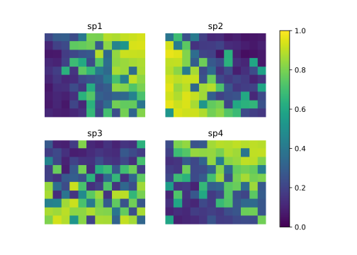
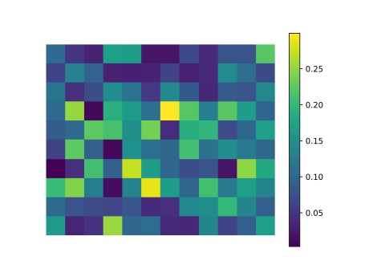
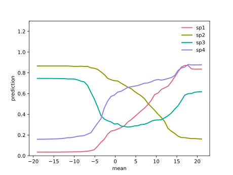
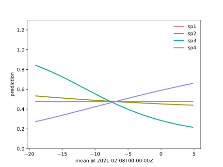

<!-- Python blocks run by tools/python_twins.py (md5 0a6f6b791007fae51469a6bc9b548f5a). -->

```{r setup, include = FALSE}
knitr::opts_chunk$set(collapse = TRUE, comment = "#>", fig.width = 6.5, fig.height = 4.5,
                      dev.args = list(pointsize = 14))
set.seed(1)
library(timesift)
if (nzchar(Sys.getenv("TIMESIFT_DOCS_CACHE"))) source(Sys.getenv("TIMESIFT_DOCS_CACHE"))
```

This article shows how to choose cross-validation folds, combine candidate predictions, set presence-absence thresholds and project predictions onto rasters. The examples use a small simulated grid and compare maps from the original temperature record with maps from a warmer version.

## Installation

::: {.lang-pair}
```{r, eval = FALSE}
# Install from CRAN
install.packages("timesift")

# Or install the development version from GitHub
# install.packages("pak")
pak::pak("gcol33/timesift")
```

```bash
# Install from PyPI
pip install timesift

# with the torch encoders, the contrasts and the plots
pip install "timesift[torch,contrasts,plot]"

# Or install the development version from GitHub
pip install git+https://github.com/gcol33/timesift
```
:::

## A record on a grid

The grid has 12 by 10 cells. Each cell carries a daily temperature record for one
year, a value of elevation, its coordinates, and the presence or absence of four species. Two
properties of a cell drive the record: `warmth` shifts the whole year up or down and runs along a
gradient across the grid, and `frost` sets how deep a cold snap in early February goes, deeper
towards the north. The first two species follow warmth in opposite directions, the third follows
the depth of the snap, and the fourth both.

::: {.lang-py-only}
The Python code simulates its own random data, so the numbers it prints differ from those quoted in the text, which come from the R run. Counts, shapes and calendar boundaries are the same in both.
:::

::: {.lang-pair}
```{r data}
nx <- 12L
ny <- 10L
cell <- seq_len(nx * ny)
x <- (cell - 1L) %% nx + 0.5
y <- ny - (cell - 1L) %/% nx - 0.5
warmth <- as.numeric(scale(0.35 * x + 0.2 * y + rnorm(length(cell), sd = 0.6)))
frost <- as.numeric(scale(-0.3 * y + rnorm(length(cell), sd = 0.8)))

days <- seq(as.POSIXct("2021-01-01", tz = "UTC"), by = "day", length.out = 365)
doy <- seq_along(days)
snap <- exp(-((doy - 40) / 5)^2)
temp <- t(vapply(cell, function(i) {
  6 + 1.5 * warmth[i] - 10 * cos(2 * pi * doy / 365) - 6 * (1 + frost[i]) * snap +
    rnorm(365, sd = 3)
}, numeric(365)))

series <- data.frame(cell = rep(cell, times = 365), day = rep(days, each = length(cell)),
                     temp = as.numeric(temp))
targets <- data.frame(cell = cell, x = x, y = y,
                      elevation = round(2200 - 150 * warmth + rnorm(length(cell), sd = 40)))
signal <- cbind(2.2 * warmth, -2.2 * warmth, 2.2 * frost, 1.5 * warmth - 1.5 * frost)
targets[paste0("sp", 1:4)] <- lapply(1:4, function(j) {
  rbinom(length(cell), 1, plogis(signal[, j] - 0.5))
})
targets$transect <- paste0("t", ny - floor(y))
colSums(targets[paste0("sp", 1:4)])
```

```python
import numpy as np
import pandas as pd
import timesift as ts

rng = np.random.default_rng(1)
nx, ny = 12, 10
cell = np.arange(1, nx * ny + 1)
gx = (cell - 1) % nx + 0.5
gy = ny - (cell - 1) // nx - 0.5


def scale(v):
    return (v - v.mean()) / v.std(ddof=1)


warmth = scale(0.35 * gx + 0.2 * gy + rng.normal(scale=0.6, size=cell.size))
frost = scale(-0.3 * gy + rng.normal(scale=0.8, size=cell.size))

days = pd.date_range("2021-01-01", periods=365, freq="D")
doy = np.arange(1, 366)
snap = np.exp(-(((doy - 40) / 5) ** 2))
temp = (6 + 1.5 * warmth[:, None] - 10 * np.cos(2 * np.pi * doy / 365)
        - 6 * (1 + frost[:, None]) * snap + rng.normal(scale=3, size=(cell.size, 365)))

series = pd.DataFrame({"cell": np.repeat(cell, 365), "day": np.tile(days, cell.size),
                       "temp": temp.ravel()})
targets = pd.DataFrame({"cell": cell, "x": gx, "y": gy,
                        "elevation": np.round(2200 - 150 * warmth + rng.normal(scale=40, size=cell.size))})
signal = np.column_stack([2.2 * warmth, -2.2 * warmth, 2.2 * frost, 1.5 * warmth - 1.5 * frost])
for j in range(4):
    targets[f"sp{j + 1}"] = rng.binomial(1, 1 / (1 + np.exp(-(signal[:, j] - 0.5))))
targets["transect"] = [f"t{int(ny - np.floor(v))}" for v in gy]
targets.filter(like="sp").sum()
#> sp1    50
#> sp2    52
#> sp3    48
#> sp4    54
#> dtype: int64
```
:::

Cells are numbered row by row from the top left, which is the order `terra` numbers the cells of a
raster in. The `temp` matrix, one row per cell and one column per day, is therefore also the content
of a raster with 365 layers, and the maps at the end are built from it directly. `transect` names
the row of the grid a cell sits in.

## The split, drawn once

Every candidate in a run uses the same fold map. Its out-of-fold predictions are used to fit the ensemble and estimate thresholds. The four constructors below specify how to divide targets into folds; the run builds the fold map from the targets.

::: {.lang-pair}
```{r resampling}
cv(v = 5)
grouped_cv("transect", v = 5)
block_cv(c("x", "y"), v = 5)
env_cv("elevation", v = 5)
```

```python
ts.cv(v=5)
#> Resampling(kind='cv', v=5, seed=1, strata=5, group=None, folds=None, by=None, scale=False, repeats=1)
ts.grouped_cv("transect", v=5)
#> Resampling(kind='grouped_cv', v=5, seed=1, strata=1, group='transect', folds=None, by=None, scale=False, repeats=1)
ts.block_cv(["x", "y"], v=5)
#> Resampling(kind='block_cv', v=5, seed=0, strata=1, group=None, folds=None, by=['x', 'y'], scale=False, repeats=1)
ts.env_cv("elevation", v=5)
#> Resampling(kind='env_cv', v=5, seed=0, strata=1, group=None, folds=None, by='elevation', scale=True, repeats=1)
```
:::

`cv()` deals units into folds within strata of the number of responses present at a unit, so each
fold carries a similar mix. `grouped_cv()` deals whole groups, so every target sharing a value of
`transect` lands in one fold. `block_cv()` cuts the units into compact blocks of the columns it is
given, here the coordinates: it halves the set at the median of the widest column and repeats until
there are `v` blocks, and nothing about it is random. `env_cv()` does the same on predictor columns,
each centred and scaled first, so that a fold holds out a region of the environment, here a band of
elevation. Both `cv()` and `grouped_cv()` take `repeats`, which draws the split again under the next
seed and makes a full run on each.

`fold_map()` is the map itself, drawn from a response matrix. With `group` it deals groups, as
`grouped_cv()` does inside a run.

::: {.lang-pair}
```{r fold-map}
resp <- as.matrix(targets[paste0("sp", 1:4)])
rownames(resp) <- targets$cell
random <- fold_map(resp, v = 5)
table(random)
by_transect <- fold_map(resp, v = 5, group = targets$transect)
table(transect = targets$transect, fold = by_transect)[1:4, ]
```

```python
resp = ts.as_response({"id": cell, **{f"sp{j}": targets[f"sp{j}"] for j in range(1, 5)}})
random = ts.fold_map(resp, v=5)
pd.Series(random.fold).value_counts().sort_index()
#> 1    24
#> 2    24
#> 3    24
#> 4    24
#> 5    24
#> Name: count, dtype: int64
by_transect = ts.fold_map(resp, v=5, group=targets["transect"])
pd.crosstab(targets["transect"], by_transect.fold).head(4)
#> col_0      1   2  3  4   5
#> transect
#> t1         0   0  0  0  12
#> t10        0  12  0  0   0
#> t2         0   0  0  0  12
#> t3        12   0  0  0   0
```
:::

The plain map puts 24 cells in each fold. The grouped one puts each transect of twelve cells in a
single fold, so two transects make one fold of 24.

A score for one response needs both presences and absences among the held-out units, and a model of
one response needs both among the units it is fitted on. `scorable_cells()` reads which
(response, fold) cells meet both conditions, from the response and the fold map alone.

::: {.lang-pair}
```{r cells}
cells <- scorable_cells(resp, random)
cells
head(as.data.frame(cells), 4)
```

```python
cells = ts.scorable_cells(resp, random)
cells
#> <timesift cells> 20 cells over 4 variables
#> scorable: 20 (100.0%); variables with at least one scorable fold: 4 of 4
pd.DataFrame({k: getattr(cells, k) for k in ("variable", "fold", "scorable")}).head(4)
#>   variable  fold  scorable
#> 0      sp1     1      True
#> 1      sp1     2      True
#> 2      sp1     3      True
#> 3      sp1     4      True
```
:::

Every one of the 20 cells is scorable here, because each species is present at between [47]{.lang-r-only}[48]{.lang-py-only py="int(resp.values.sum(axis=0).min())"} and [59]{.lang-r-only}[54]{.lang-py-only py="int(resp.values.sum(axis=0).max())"} of
the 120 cells. With a rare species some folds would hold no presence, and those cells would drop out
of every candidate's score at once. Because no model enters the mask, all candidates share one
denominator.

## One run under two splits

The run fits two learners at two grains, an elastic net and a random forest at the week and at the
month, with elevation carried as a static predictor. It is made twice: once under a random
five-fold split and once under five spatial blocks.

::: {.lang-pair}
```{r fit}
fit <- timesift(targets, series, y = starts_with("sp"), id = cell, time = day, x = temp,
                static = elevation, learners = c(elasticnet(), forest()),
                sift = grains("week", "month"), resampling = cv(v = 5), verbose = FALSE)
fit
```

```python
fit = ts.timesift(targets, series, y="sp*", id="cell", time="day", x="temp",
                  static="elevation", learners=[ts.elasticnet(), ts.forest()],
                  sift=ts.grains("week", "month"), resampling=ts.cv(v=5), verbose=False)
fit
#> timesift  120 targets, 4 responses, 5-fold random CV, roc_auc
#>
#> candidates, scored on the outer folds
#> candidate                    mean    won  responses
#> forest / month              0.795      0  separate
#> forest / week               0.813      0  separate
#> elasticnet / week           0.832      1  separate
#> elasticnet / month          0.845      3  separate
#>
#> procedure, chosen and weighted inside each outer training fold
#> selected                    0.832  se 0.007
#> ensemble                    0.820  se 0.010
#> selected elasticnet / week in 3, elasticnet / month in 2 of 5 folds
#>
#> choice on every target  elasticnet / month
#> weights on every target  forest / week 0.41   elasticnet / month 0.32   forest / month 0.27
```
:::

The candidate rows are the comparison on the outer folds, and the two procedure rows are the
held-out level. Inside each outer training fold the candidates were cross-validated again on five
inner folds; one was chosen on its inner score and the stack's weights were fitted on the inner
out-of-fold predictions, and both then predicted the outer test fold once. Under the random split
the selected candidate scores an AUC of [0.866]{.lang-r-only}[0.832]{.lang-py-only py="f'{next(e['score'] for e in fit.estimate if e['metric'] == 'roc_auc' and e['arm'] == 'selected'):.3f}'"} and the stack [0.861]{.lang-r-only}[0.820]{.lang-py-only py="f'{next(e['score'] for e in fit.estimate if e['metric'] == 'roc_auc' and e['arm'] == 'ensemble'):.3f}'"}.

The block run differs in two settings, and both follow from the blocks. The inner split of a nested
run deals whole blocks as the outer one does, so with five blocks an outer training set holds four
and `n_inner` can be at most 4. The elastic net chooses its penalty on folds of its own, which keep
blocks whole as well; an inner training set then holds three blocks, and `elasticnet(n_inner = 3L)`
asks for no more folds than that. Its default of ten would ask for more folds than there are blocks,
which is an error.

::: {.lang-pair}
```{r fit-block}
blocked <- timesift(targets, series, y = starts_with("sp"), id = cell, time = day, x = temp,
                    static = elevation, learners = c(elasticnet(n_inner = 3L), forest()),
                    sift = grains("week", "month"), resampling = block_cv(c("x", "y"), v = 5),
                    n_inner = 4L, verbose = FALSE)
blocked
```

```python
blocked = ts.timesift(targets, series, y="sp*", id="cell", time="day", x="temp",
                      static="elevation", learners=[ts.elasticnet(n_inner=3), ts.forest()],
                      sift=ts.grains("week", "month"), resampling=ts.block_cv(["x", "y"], v=5),
                      n_inner=4, verbose=False)
blocked
#> timesift  120 targets, 4 responses, 5-fold grouped CV, roc_auc
#>
#> candidates, scored on the outer folds
#> candidate                    mean    won  responses
#> forest / month              0.699      0  separate
#> forest / week               0.705      0  separate
#> elasticnet / week           0.765      2  separate
#> elasticnet / month          0.782      2  separate
#>
#> procedure, chosen and weighted inside each outer training fold
#> selected                    0.776  se 0.042
#> ensemble                    0.758  se 0.040
#> selected elasticnet / month in 4, elasticnet / week in 1 of 5 folds
#>
#> choice on every target  elasticnet / month
#> weights on every target  forest / month 0.36   forest / week 0.34   elasticnet / month 0.31
```
:::

Each run keeps the map it read in `$folds`. Drawn on the grid, the random map scatters every fold
over the grid and the block map gives each fold one compact region.

::: {.lang-pair}
```{r fold-maps, fig.height = 3.2, fig.alt = "Two maps of the 12 by 10 grid coloured by fold: scattered under cv(), five compact regions under block_cv()."}
op <- par(mfrow = c(1, 2), mar = c(1, 1, 2, 1))
show_folds <- function(f, main) {
  m <- matrix(f[as.character(cell)], nrow = ny, ncol = nx, byrow = TRUE)
  image(seq_len(nx), seq_len(ny), t(m[ny:1, ]), col = hcl.colors(5, "Set 2"),
        axes = FALSE, xlab = "", ylab = "", main = main)
}
show_folds(fit$folds, "cv(v = 5)")
show_folds(blocked$folds, "block_cv(c(\"x\", \"y\"), v = 5)")
par(op)
```

```{.python fig-alt="Two maps of the 12 by 10 grid coloured by fold: scattered under cv(), five compact regions under block_cv()."}
import matplotlib.pyplot as plt

fig, axes = plt.subplots(1, 2, figsize=(7, 3.2))
for ax, run, title in zip(axes, (fit, blocked), ("cv(v = 5)", 'block_cv(["x", "y"], v = 5)')):
    by_cell = run.folds.as_dict()
    ax.imshow(np.array([by_cell[str(c)] for c in cell]).reshape(ny, nx),
              cmap=plt.get_cmap("Set2", 5));
    ax.set_title(title);
    ax.axis("off");
```


:::

::: {.lang-pair}
```{r estimates}
est <- function(run) run$estimate[run$estimate$metric == "roc_auc", c("arm", "score", "se")]
rbind(random = est(fit), block = est(blocked))
```

```python
def est(run):
    d = pd.DataFrame(run.estimate)
    return d[d["metric"] == "roc_auc"][["arm", "score", "se"]].reset_index(drop=True)


pd.concat({"random": est(fit), "block": est(blocked)})
#>                arm     score        se
#> random 0  selected  0.832447  0.007001
#>        1  ensemble  0.819756  0.009880
#> block  0  selected  0.776500  0.041876
#>        1  ensemble  0.757886  0.039561
```
:::

Under blocks the selected candidate falls by [0.082]{.lang-r-only}[0.056]{.lang-py-only py="f'{next(e['score'] for e in fit.estimate if e['metric'] == 'roc_auc' and e['arm'] == 'selected') - next(e['score'] for e in blocked.estimate if e['metric'] == 'roc_auc' and e['arm'] == 'selected'):.3f}'"}, to [0.784]{.lang-r-only}[0.776]{.lang-py-only py="f'{next(e['score'] for e in blocked.estimate if e['metric'] == 'roc_auc' and e['arm'] == 'selected'):.3f}'"}, and the stack by [0.070]{.lang-r-only}[0.062]{.lang-py-only py="f'{next(e['score'] for e in fit.estimate if e['metric'] == 'roc_auc' and e['arm'] == 'ensemble') - next(e['score'] for e in blocked.estimate if e['metric'] == 'roc_auc' and e['arm'] == 'ensemble'):.3f}'"}, to [0.791]{.lang-r-only}[0.758]{.lang-py-only py="f'{next(e['score'] for e in blocked.estimate if e['metric'] == 'roc_auc' and e['arm'] == 'ensemble'):.3f}'"}. The
likely reason is the gradient: in the random split a held-out cell nearly always has neighbours on
the training side at the same position on the warmth gradient, while under blocks a whole region is
held out and the model has to reach a stretch of the gradient it saw less of. The block number is the
one that describes prediction into a part of the grid the fit was not trained in. The ranking
of the candidates keeps its order between the two runs, and the forests lose more than the elastic
nets: [0.840]{.lang-r-only}[0.795]{.lang-py-only py="f'{dict((r['candidate'], r['mean']) for r in ts.candidate_table(fit))['forest / month']:.3f}'"} to [0.682]{.lang-r-only}[0.699]{.lang-py-only py="f'{dict((r['candidate'], r['mean']) for r in ts.candidate_table(blocked))['forest / month']:.3f}'"} at the month, against [0.870]{.lang-r-only}[0.845]{.lang-py-only py="f'{dict((r['candidate'], r['mean']) for r in ts.candidate_table(fit))['elasticnet / month']:.3f}'"} to [0.784]{.lang-r-only}[0.782]{.lang-py-only py="f'{dict((r['candidate'], r['mean']) for r in ts.candidate_table(blocked))['elasticnet / month']:.3f}'"}.

## The combination

The combiner uses out-of-fold predictions, observed responses, the scorable-cell mask and the fold map. The default, `ensemble("stack")`, estimates non-negative weights that sum to one and minimise binomial deviance over the scorable cells. One weight vector is used across all responses.

::: {.lang-pair}
```{r weights}
round(ensemble_weights(fit), 3)
fold_w <- fit$fold_weights
fold_w[-1] <- round(fold_w[-1], 3)
fold_w
fit$selected[c("fold", "candidate", "inner_score")]
```

```python
{k: round(v, 3) for k, v in ts.ensemble_weights(fit).items()}
#> {'elasticnet / week': 0.0, 'elasticnet / month': 0.324, 'forest / week': 0.41, 'forest / month': 0.266}
pd.DataFrame(fit.fold_weights).round(3)
#>    fold  elasticnet / week  elasticnet / month  forest / week  forest / month
#> 0     1              0.541               0.000          0.279           0.180
#> 1     2              0.286               0.000          0.356           0.358
#> 2     3              0.000               0.344          0.163           0.494
#> 3     4              0.196               0.091          0.381           0.332
#> 4     5              0.000               0.324          0.124           0.552
pd.DataFrame(fit.selected)[["fold", "candidate", "inner_score"]]
#>    fold           candidate  inner_score
#> 0     1   elasticnet / week     0.847644
#> 1     2   elasticnet / week     0.864787
#> 2     3  elasticnet / month     0.852545
#> 3     4   elasticnet / week     0.854386
#> 4     5  elasticnet / month     0.819974
```
:::

`ensemble_weights()` returns the weights fitted on the outer out-of-fold predictions of every
target, which are the weights `predict()` uses. They put [0.516]{.lang-r-only}[0.410]{.lang-py-only py="f'{ts.ensemble_weights(fit)['forest / week']:.3f}'"} on the weekly forest, [0.264]{.lang-r-only}[0.324]{.lang-py-only py="f'{ts.ensemble_weights(fit)['elasticnet / month']:.3f}'"} on the
monthly elastic net and [0.220]{.lang-r-only}[0.266]{.lang-py-only py="f'{ts.ensemble_weights(fit)['forest / month']:.3f}'"} on the monthly forest, and nothing on the weekly elastic net. Those
weights were fitted to the responses the run is scored against, so the ensemble's score is never
read with them. `fit$fold_weights` holds the weights each
outer fold fitted on its own training targets, and these are the ones behind the held-out
`ensemble` row. They move between folds: the weekly forest takes [0.968]{.lang-r-only}[0.279]{.lang-py-only py="f'{next(r['forest / week'] for r in fit.fold_weights if r['fold'] == 1):.3f}'"} in fold 1 and [0.318]{.lang-r-only}[0.163]{.lang-py-only py="f'{next(r['forest / week'] for r in fit.fold_weights if r['fold'] == 3):.3f}'"} in
fold 3. `fit$selected` shows the same instability for the single choice, which alternates between
the two elastic nets.

`ensemble()` offers five methods. `"stack"` fits the weights; `"mean"` and `"median"` combine
without fitting anything; `"weighted"` weights each candidate by its mean score, with `decay` to
weight by rank as biomod2's `EMwmean.decay` does; and `"committee"` cuts each member at its own
threshold and averages the votes. `min_score` drops any candidate whose mean score is below it, and
`scope` narrows the members to the learners at the best representation or to the best learner
across representations. A run takes one of these as `ensemble =`.

`ensemble_fit()` is the combiner on its own. Given the run's out-of-fold predictions it fits any of
the five, and `ensemble_combine()` applies the result to a set of member predictions.

::: {.lang-pair}
```{r methods}
methods <- c("stack", "mean", "median", "weighted", "committee")
stacks <- lapply(setNames(methods, methods), function(m) {
  ensemble_fit(fit$oof, fit$y, fit$cells, fit$folds, ensemble(m), scores = fit$scores)
})
stacks$stack
round(stacks$committee$thresholds, 3)
```

```python
methods = ["stack", "mean", "median", "weighted", "committee"]
stacks = {m: ts.ensemble_fit(fit.oof, fit.y, fit.cells, fit.folds, ts.ensemble(m),
                             scores=fit.scores) for m in methods}
stacks["stack"]
#> <timesift stack> stack over 4 candidates
#> forest / week 0.410  elasticnet / month 0.324  forest / month 0.266  elasticnet / week 0.000
committee = stacks["committee"]
pd.DataFrame(committee.thresholds, index=committee.members, columns=committee.variables).round(3)
#>                       sp1    sp2    sp3    sp4
#> elasticnet / week   0.522  0.595  0.478  0.547
#> elasticnet / month  0.561  0.530  0.441  0.505
#> forest / week       0.472  0.506  0.496  0.562
#> forest / month      0.664  0.578  0.456  0.506
```
:::

The stack refitted here carries the same weights as `ensemble_weights(fit)`, because it was fitted
on the same predictions. The committee holds one cut per member and response, learned by the
`"youden"` rule from that member's out-of-fold predictions.

Each combination can be scored on the outer folds with `score_predictions()`, which reads any
prediction matrix on the cells the mask allows. The mean and the median fit nothing to the response,
so their scores are held-out scores. The stack, the weighted mean and the committee were fitted on
the same predictions they are scored on here, so their scores are optimistic, and the nested
`estimate` is the one to quote for them.

::: {.lang-pair}
```{r methods-score}
auc <- vapply(stacks, function(st) {
  s <- score_predictions(fit$y, ensemble_combine(st, fit$oof), fit$folds, fit$cells)
  mean(tapply(s$score[s$scorable], s$variable[s$scorable], mean))
}, numeric(1))
round(auc, 3)
```

```python
def mean_auc(st):
    s = ts.score_predictions(fit.y, ts.ensemble_combine(st, fit.oof), fit.folds, fit.cells)
    d = pd.DataFrame({k: s[k] for k in ("variable", "score", "scorable")})
    return d[d["scorable"]].groupby("variable")["score"].mean().mean()


pd.Series({m: mean_auc(st) for m, st in stacks.items()}).round(3)
#> stack        0.826
#> mean         0.831
#> median       0.833
#> weighted     0.830
#> committee    0.818
#> dtype: float64
```
:::

The plain mean of the four candidates scores [0.870]{.lang-r-only}[0.831]{.lang-py-only py="f'{mean_auc(stacks['mean']):.3f}'"}[, level with the best single candidate's 0.870]{.lang-r-only}[, ]{.lang-py-only}[0.015 below]{.lang-py-only py="(lambda d: 'level with' if abs(d) < 0.0005 else '{:.3f} {}'.format(abs(d), 'below' if d < 0 else 'above'))(mean_auc(stacks['mean']) - max(r['mean'] for r in ts.candidate_table(fit)))"}[ the best single candidate's ]{.lang-py-only}[0.845]{.lang-py-only py="f'{max(r['mean'] for r in ts.candidate_table(fit)):.3f}'"} on
the same folds, and the median [0.868]{.lang-r-only}[0.833]{.lang-py-only py="f'{mean_auc(stacks['median']):.3f}'"}. The committee scores [0.834]{.lang-r-only}[0.818]{.lang-py-only py="f'{mean_auc(stacks['committee']):.3f}'"}. With four members, a committee's
prediction is a share of four votes and takes only five values, so it ranks the units coarsely,
and AUC reads the ranking.

`ensemble_spread()` reads the members side by side instead of combining them: for each target and
response the weighted mean, standard deviation, coefficient of variation and an interval. It is the
counterpart of biomod2's `EMcv` and `EMci`.

::: {.lang-pair}
```{r spread}
sp <- ensemble_spread(stacks$mean, fit$oof)
round(sp[1:4, "sp3", ], 3)
```

```python
sp = ts.ensemble_spread(stacks["mean"], fit.oof)
pd.DataFrame(sp[:4, 2, :], columns=ts.SPREAD_STATISTICS).round(3)
#>     mean     sd     cv  lower  upper
#> 0  0.414  0.061  0.147  0.317  0.511
#> 1  0.208  0.067  0.323  0.101  0.315
#> 2  0.204  0.095  0.467  0.053  0.356
#> 3  0.323  0.103  0.319  0.159  0.487
```
:::

## What the report carries

Printing a run displays its `summary()`, documented under `timesift_report`. The summary is a data frame with one row per candidate and one per procedure, so you can filter and join it. Attributes store the ensemble weights and selected candidate from the fit using all targets.

::: {.lang-pair}
```{r report}
report <- as.data.frame(summary(fit))
report[c("candidate", "mean", "se", "won", "scored")]
attr(summary(fit), "choice")
```

```python
pd.DataFrame(ts.candidate_table(fit))
#>             candidate responses  won      mean
#> 0      forest / month  separate    0  0.794861
#> 1       forest / week  separate    0  0.813303
#> 2   elasticnet / week  separate    1  0.831971
#> 3  elasticnet / month  separate    3  0.845478
fit.choice
#> elasticnet / month
```
:::

`won` counts the responses a candidate scored highest on: the monthly elastic net wins three, the
weekly one wins the fourth, and the weekly forest, which carries the largest weight in the stack,
wins none. A candidate can carry the combination without being best on any single response, which
the mean alone would not show. The `se` of the two procedure rows is across the four responses, all
fitted and scored on the same cells, so it does not include the error those share.

## Predicting new targets

`predict()` rebuilds each candidate's representation for the new targets and uses models refitted on all training targets. Supply the identifier and any static predictor columns in the new target table, plus a time series for each target.

::: {.lang-pair}
```{r predict}
new <- targets[1:6, c("cell", "elevation")]
new_series <- series[series$cell %in% new$cell, ]
round(predict(fit, new, new_series), 3)
round(predict(fit, new, new_series, candidate = "selected"), 3)
round(predict(fit, new, new_series, candidate = "forest / week"), 3)
```

```python
new = targets.iloc[:6][["cell", "elevation"]]
new_series = series[series["cell"].isin(new["cell"])]


def show(p):
    return pd.DataFrame(p, index=new["cell"], columns=fit.y.variables).round(3)


show(fit.predict(new, new_series))
#>         sp1    sp2    sp3    sp4
#> cell
#> 1     0.212  0.388  0.279  0.234
#> 2     0.286  0.688  0.101  0.803
#> 3     0.298  0.245  0.089  0.837
#> 4     0.231  0.412  0.176  0.256
#> 5     0.400  0.189  0.811  0.277
#> 6     0.799  0.115  0.117  0.863
show(fit.predict(new, new_series, candidate="selected"))
#>         sp1    sp2    sp3    sp4
#> cell
#> 1     0.370  0.641  0.388  0.447
#> 2     0.438  0.482  0.131  0.621
#> 3     0.484  0.427  0.081  0.710
#> 4     0.405  0.608  0.375  0.470
#> 5     0.626  0.316  0.614  0.492
#> 6     0.615  0.216  0.096  0.734
show(fit.predict(new, new_series, candidate="forest / week"))
#>         sp1    sp2    sp3    sp4
#> cell
#> 1     0.138  0.276  0.268  0.116
#> 2     0.220  0.798  0.120  0.866
#> 3     0.202  0.148  0.068  0.872
#> 4     0.136  0.318  0.060  0.158
#> 5     0.288  0.090  0.900  0.202
#> 6     0.868  0.086  0.118  0.922
```
:::

`candidate = "ensemble"` is the default and combines the members under the refitted stack;
`"selected"` is the candidate the rule chose on every target, here `elasticnet / month`; any
candidate's name predicts with that candidate alone. The selected elastic net's predictions lie
closer to one half than the ensemble's, which carries [half its weight]{.lang-r-only}[0.41 of its weight]{.lang-py-only py="f'{ts.ensemble_weights(fit)['forest / week']:.2f} of its weight'"} on a forest whose predictions
reach further towards zero and one.

## Thresholds

`type = "binary"` cuts each response at a threshold learned from the same candidate's out-of-fold
predictions of the fit's own targets, so the cut comes from predictions of units the model had not
been fitted on. `decision_threshold()` on the fit returns the cuts, one per response, and `rule`
picks how they are learned.

::: {.lang-pair}
```{r thresholds}
rules <- c("youden", "kappa", "prevalence", "mpa")
round(sapply(rules, function(r) decision_threshold(fit, rule = r)), 3)
```

```python
rules = ["youden", "kappa", "prevalence", "mpa"]
thresholds = pd.DataFrame({r: ts.decision_threshold(fit, rule=r) for r in rules}).round(3)
thresholds
#>      youden  kappa  prevalence    mpa
#> sp1   0.455  0.614       0.513  0.320
#> sp2   0.536  0.536       0.444  0.242
#> sp3   0.448  0.448       0.505  0.303
#> sp4   0.464  0.464       0.494  0.332
```
:::

`"youden"` maximises sensitivity plus specificity, the cut TSS is read at. `"kappa"` maximises
Cohen's kappa. `"prevalence"` predicts as many presences as were observed, and reads nothing from
which units held them. `"mpa"`, the minimum predicted area, takes the highest cut that keeps a share
`perc` of the observed presences, 0.9 by default, so it reads the presences alone. Here youden and
kappa agree on three species and part on [`sp4`]{.lang-r-only}[`sp1`]{.lang-py-only py="'`' + thresholds[thresholds['youden'] != thresholds['kappa']].index[0] + '`'"}, [0.467]{.lang-r-only}[0.455]{.lang-py-only py="f'{thresholds[thresholds['youden'] != thresholds['kappa']]['youden'].iloc[0]:.3f}'"} against [0.640]{.lang-r-only}[0.614]{.lang-py-only py="f'{thresholds[thresholds['youden'] != thresholds['kappa']]['kappa'].iloc[0]:.3f}'"}, and mpa cuts lowest on every
species. The number of cells each rule calls present, against the observed count:

::: {.lang-pair}
```{r threshold-counts}
called <- sapply(rules, function(r) colSums(predict(fit, targets, series, type = "binary", rule = r)))
cbind(observed = colSums(resp), called)
predict(fit, new, new_series, type = "binary", rule = "prevalence")
```

```python
called = pd.DataFrame({r: fit.predict(targets, series, type="binary", rule=r).sum(axis=0)
                       for r in rules}, index=fit.y.variables)
called.insert(0, "observed", resp.values.sum(axis=0).astype(int))
called
#>      observed  youden  kappa  prevalence   mpa
#> sp1        50    51.0   49.0        51.0  65.0
#> sp2        52    52.0   52.0        54.0  69.0
#> sp3        48    52.0   52.0        49.0  62.0
#> sp4        54    54.0   54.0        54.0  61.0
show(fit.predict(new, new_series, type="binary", rule="prevalence"))
#>       sp1  sp2  sp3  sp4
#> cell
#> 1     0.0  0.0  0.0  0.0
#> 2     0.0  1.0  0.0  1.0
#> 3     0.0  0.0  0.0  1.0
#> 4     0.0  0.0  0.0  0.0
#> 5     0.0  0.0  1.0  0.0
#> 6     1.0  0.0  0.0  1.0
```
:::

The prevalence rule reproduces the observed counts to within [one cell]{.lang-r-only}[2 cells]{.lang-py-only py="f'{int((called['prevalence'] - called['observed']).abs().max())} cell' + ('s' if int((called['prevalence'] - called['observed']).abs().max()) != 1 else '')"}, as it is built to. Youden and
kappa land within [two cells]{.lang-r-only}[4 cells]{.lang-py-only py="f'{int(max((called['youden'] - called['observed']).abs().max(), (called['kappa'] - called['observed']).abs().max()))} cell' + ('s' if int(max((called['youden'] - called['observed']).abs().max(), (called['kappa'] - called['observed']).abs().max())) != 1 else '')"} of them on this grid, and mpa calls between [53]{.lang-r-only}[61]{.lang-py-only py="int(called['mpa'].min())"} and [74]{.lang-r-only}[69]{.lang-py-only py="int(called['mpa'].max())"} cells present
against [47]{.lang-r-only}[48]{.lang-py-only py="int(resp.values.sum(axis=0).min())"} to [59]{.lang-r-only}[54]{.lang-py-only py="int(resp.values.sum(axis=0).max())"} observed, because it gives up specificity to keep nine presences in ten. The
binary matrix is integer, 1 for presence, and a response whose held-out predictions give no cut
would be `NA`.

## How far the members disagree

`type = "spread"` returns `ensemble_spread()` on the members' predictions for new targets, a
`[target, response, statistic]` array.

::: {.lang-pair}
```{r spread-predict}
s <- predict(fit, new, new_series, type = "spread")
round(s[, "sp1", ], 3)
```

```python
s = fit.predict(new, new_series, type="spread")
pd.DataFrame(s[:, 0, :], index=new["cell"], columns=ts.SPREAD_STATISTICS).round(3)
#>        mean     sd     cv  lower  upper
#> cell
#> 1     0.212  0.135  0.640  0.000  0.464
#> 2     0.286  0.130  0.453  0.044  0.528
#> 3     0.298  0.160  0.536  0.000  0.595
#> 4     0.231  0.149  0.646  0.000  0.509
#> 5     0.400  0.192  0.480  0.041  0.759
#> 6     0.799  0.160  0.200  0.501  1.000
```
:::

The interval is held inside zero and one, since the predictions are probabilities. Where the mean is
small the coefficient of variation is large: the first three cells[ sit below 0.15 with a
coefficient above one]{.lang-r-only}[ have means from ]{.lang-py-only}[0.212]{.lang-py-only py="f'{s[:3, 0, 0].min():.3f}'"}[ to ]{.lang-py-only}[0.298]{.lang-py-only py="f'{s[:3, 0, 0].max():.3f}'"}[ with coefficients from ]{.lang-py-only}[0.453]{.lang-py-only py="f'{s[:3, 0, 2].min():.3f}'"}[ to ]{.lang-py-only}[0.640]{.lang-py-only py="f'{s[:3, 0, 2].max():.3f}'"}, while cell [5]{.lang-r-only}[6]{.lang-py-only py="int(new['cell'].iloc[int(np.argmax(s[:, 0, 0]))])"} has a mean of [0.798]{.lang-r-only}[0.799]{.lang-py-only py="f'{s[int(np.argmax(s[:, 0, 0])), 0, 0]:.3f}'"} and a coefficient of [0.178]{.lang-r-only}[0.200]{.lang-py-only py="f'{s[int(np.argmax(s[:, 0, 0])), 0, 2]:.3f}'"}. On one target
per map cell this is an uncertainty map, and the sections on maps below draw one.

## Presence-only records

Presence-only data give a response of ones. `pseudo_absences()` draws units to stand as absences
from a pool of background units, by biomod2's three strategies: `"random"` takes any unit that is
not a presence, `"sre"` a unit outside the envelope of the presences in the `env` columns, and
`"disk"` a unit whose distance to the nearest presence lies between `dist_min` and `dist_max`. A unit
of the pool whose `id` is a presence is never drawn.

::: {.lang-pair}
```{r pseudo}
presences <- targets[targets$sp3 == 1, c("cell", "x", "y", "elevation")]
pool <- targets[c("cell", "x", "y", "elevation")]
pseudo_absences(pool, presences, n = 10, strategy = "disk", id = "cell",
                coords = c("x", "y"), dist_min = 1.5)
pseudo_absences(pool, presences, n = 10, strategy = "sre", id = "cell", env = "elevation",
                quantile = 0.1)
```

```python
presences = targets[targets["sp3"] == 1][["cell", "x", "y", "elevation"]]
pool = targets[["cell", "x", "y", "elevation"]].to_dict("list")
presence_rows = presences.to_dict("list")
pd.DataFrame(ts.pseudo_absences(pool, presence_rows, n=10, strategy="disk", id="cell",
                                coords=["x", "y"], dist_min=1.5))
#>    cell    x    y  elevation  set  pseudo
#> 0     1  0.5  9.5     2283.0    1    True
#> 1     2  1.5  9.5     2263.0    1    True
#> 2     3  2.5  9.5     2199.0    1    True
#> 3     7  6.5  9.5     2131.0    1    True
#> 4     8  7.5  9.5     2048.0    1    True
#> 5     9  8.5  9.5     1992.0    1    True
#> 6    13  0.5  8.5     2381.0    1    True
#> 7    15  2.5  8.5     2196.0    1    True
#> 8    20  7.5  8.5     2037.0    1    True
#> 9    21  8.5  8.5     2110.0    1    True
pd.DataFrame(ts.pseudo_absences(pool, presence_rows, n=10, strategy="sre", id="cell",
                                env=["elevation"], quantile=0.1))
#>    cell     x    y  elevation  set  pseudo
#> 0     9   8.5  9.5     1992.0    1    True
#> 1    10   9.5  9.5     1957.0    1    True
#> 2    11  10.5  9.5     2019.0    1    True
#> 3    24  11.5  8.5     1903.0    1    True
#> 4    26   1.5  7.5     2460.0    1    True
#> 5    34   9.5  7.5     1880.0    1    True
#> 6    35  10.5  7.5     1947.0    1    True
#> 7    48  11.5  6.5     2003.0    1    True
#> 8    63   2.5  4.5     2492.0    1    True
#> 9    71  10.5  4.5     2001.0    1    True
```
:::

The header says how many units of the pool a strategy admits. On this grid the disk strategy admits
[18]{.lang-r-only}[14]{.lang-py-only py="int((np.sqrt((np.array(pool['x'])[:, None] - np.array(presence_rows['x'])) ** 2 + (np.array(pool['y'])[:, None] - np.array(presence_rows['y'])) ** 2).min(axis=1) >= 1.5).sum())"} cells at least 1.5 cells from any presence, and the envelope strategy [15]{.lang-r-only}[13]{.lang-py-only py="int(((np.array(pool['elevation']) < np.quantile(presence_rows['elevation'], 0.1)) | (np.array(pool['elevation']) > np.quantile(presence_rows['elevation'], 0.9)))[~np.isin(pool['cell'], presence_rows['cell'])].sum())"} cells outside the band
holding the middle 80% of the presences' elevations; asking either for more than it admits is an
error that names both counts. `repeats` makes several independent draws, numbered in `set`.

::: {.lang-py-only}
In Python the draw is a mapping of columns with no header; asking for more units than a strategy admits raises the same error naming both counts.
:::

::: {.lang-pair}
```{r pseudo-fit}
drawn <- pseudo_absences(pool, presences, n = 40, strategy = "random", id = "cell", repeats = 3)
table(drawn$set)
one <- drawn[drawn$set == 1, c("cell", "x", "y", "elevation")]
po <- rbind(cbind(presences, sp3 = 1), cbind(one, sp3 = 0))
po_fit <- timesift(po, series[series$cell %in% po$cell, ], y = sp3, id = cell, time = day,
                   x = temp, learners = elasticnet(), sift = grains("week"),
                   ensemble = FALSE, n_inner = NULL, resampling = cv(v = 5), verbose = FALSE)
po_fit
```

```python
drawn = pd.DataFrame(ts.pseudo_absences(pool, presence_rows, n=40, strategy="random", id="cell",
                                       repeats=3))
drawn["set"].value_counts().sort_index()
#> set
#> 1    40
#> 2    40
#> 3    40
#> Name: count, dtype: int64
one = drawn[drawn["set"] == 1][["cell", "x", "y", "elevation"]]
po = pd.concat([presences.assign(sp3=1), one.assign(sp3=0)])
po_fit = ts.timesift(po, series[series["cell"].isin(po["cell"])], y="sp3", id="cell", time="day",
                     x="temp", learners=[ts.elasticnet()], sift=ts.grains("week"),
                     ensemble=False, n_inner=None, resampling=ts.cv(v=5), verbose=False)
po_fit
#> timesift  88 targets, 1 response, 5-fold random CV, roc_auc
#>
#> candidates, scored on the outer folds
#> candidate                   mean    won  responses
#> elasticnet / week          0.854      1  separate
#>
#> choice on every target  elasticnet / week
```
:::

The drawn units are ordinary rows once bound to the presences with a response of zero, and the fit
does not mark them. Its AUC of [0.772]{.lang-r-only}[0.854]{.lang-py-only py="f'{ts.candidate_table(po_fit)[0]['mean']:.3f}'"} separates presences from background cells, some of which hold
the species, so it is a different quantity from the AUC of the presence-absence run above. A fit per
draw, each scored the same way, shows how much the result depends on which cells were drawn.

## Maps

`project()` predicts one target per raster cell, each carrying the record of its own cell, and
returns a raster with one layer per response. The record is a `SpatRaster` whose layers are
instants, set with `terra::time()`, and the static predictors are a raster whose layers are named
as the fit's `static` columns. The fit must have been made with `id`, because a cell is named by its
number.

::: {.lang-py-only}
In Python the record is an `xarray.DataArray` with a `time` dimension and two spatial ones, and the static predictors are an `xarray.Dataset` whose variables are named as the fit's `static` columns. The result is an `xarray.DataArray` with a `response` dimension.
:::

::: {.lang-pair}
```{r rasters, eval = requireNamespace("terra", quietly = TRUE)}
grid <- terra::rast(nrows = ny, ncols = nx, xmin = 0, xmax = nx, ymin = 0, ymax = ny,
                    nlyrs = 365)
terra::values(grid) <- temp
terra::time(grid) <- days
elev <- terra::rast(grid, nlyrs = 1)
terra::values(elev) <- targets$elevation
names(elev) <- "elevation"
grid
```

```python
import xarray as xr

coords = {"y": gy[::nx], "x": gx[:nx]}
grid = xr.DataArray(temp.T.reshape(365, ny, nx), dims=("time", "y", "x"),
                    coords={"time": days.to_numpy(), **coords})
elev = xr.Dataset({"elevation": (("y", "x"), targets["elevation"].to_numpy().reshape(ny, nx))},
                  coords=coords)
dict(grid.sizes)
#> {'time': 365, 'y': 10, 'x': 12}
```
:::

::: {.lang-pair}
```{r project, eval = requireNamespace("terra", quietly = TRUE), fig.alt = "Four maps of the predicted probability of presence, one per species."}
took <- system.time(now <- project(fit, series = grid, static = elev))
took[["elapsed"]]
now
all.equal(as.numeric(terra::values(now[["sp1"]])),
          as.numeric(predict(fit, targets, series)[as.character(cell), "sp1"]))
terra::plot(now)
```

```{.python fig-alt="Four maps of the predicted probability of presence, one per species."}
import time

start = time.perf_counter()
now = ts.project(fit, series=grid, static=elev)
took = time.perf_counter() - start
round(took, 2)
#> 0.09
dict(now.sizes)
#> {'response': 4, 'y': 10, 'x': 12}
bool(np.allclose(now.sel(response="sp1").values.ravel(), fit.predict(targets, series)[:, 0]))
#> True
fig, axes = plt.subplots(2, 2, figsize=(7, 5))
for ax, r in zip(axes.flat, now["response"].values):
    im = ax.imshow(now.sel(response=r).values, vmin=0, vmax=1)
    ax.set_title(r);
    ax.axis("off");
fig.colorbar(im, ax=axes);
```



:::

The projection of the ensemble onto the 120 cells took
[`r if (exists("took")) round(took[["elapsed"]], 2) else "a fraction of a"`]{.lang-r-only}[0.09]{.lang-py-only py="f'{took:.2f}'"} seconds. It is the same
prediction `predict()` gives for the same cells as targets, which `all.equal()` confirms for
`sp1`. A raster
too large for memory is read `chunk` cells at a time, 5000 by default. A cell missing a reading
anywhere in its record is `NA` in every layer.

A map for another period is the same call with that period's record. Here the later record is the
present one warmed by 1.5 degrees throughout, with elevation unchanged. `type = "binary"` cuts each
layer at the threshold `decision_threshold()` learns for the fit, and `range_change()` counts the
cells each species loses, keeps and gains between the two binary maps.

::: {.lang-pair}
```{r range, eval = requireNamespace("terra", quietly = TRUE), fig.alt = "Map of the cells sp1 loses, keeps, gains, or is absent from in both periods."}
warmer <- grid + 1.5
terra::time(warmer) <- days
now_bin <- project(fit, series = grid, static = elev, type = "binary")
later_bin <- project(fit, series = warmer, static = elev, type = "binary")
change <- range_change(now_bin, later_bin)
change
plot(change, "sp1")
```

```{.python fig-alt="Map of the cells sp1 loses, keeps, gains, or is absent from in both periods."}
warmer = grid + 1.5
now_bin = ts.project(fit, series=grid, static=elev, type="binary")
later_bin = ts.project(fit, series=warmer, static=elev, type="binary")
change = ts.range_change(now_bin, later_bin)
pd.DataFrame(change.table).drop(columns=["current", "later"]).round(1)
#>   variable  lost  kept  gained  absent  percent_loss  percent_gain  change
#> 0      sp1     0    51      45      24           0.0          88.2    88.2
#> 1      sp2    36    16       2      66          69.2           3.8   -65.4
#> 2      sp3    12    40       9      59          23.1          17.3    -5.8
#> 3      sp4     4    50      38      28           7.4          70.4    63.0
from matplotlib.colors import ListedColormap

fig, ax = plt.subplots()
ax.imshow(change.map.sel(response="sp1").values, vmin=-2.5, vmax=1.5,
          cmap=ListedColormap(["tab:red", "tab:gray", "whitesmoke", "tab:green"]));
ax.axis("off");
```


:::

The warm-favoured `sp1` and `sp4` gain [30]{.lang-r-only}[45]{.lang-py-only py="int(pd.DataFrame(change.table).set_index('variable').loc['sp1', 'gained'])"} and [38]{.lang-r-only}[38]{.lang-py-only py="int(pd.DataFrame(change.table).set_index('variable').loc['sp4', 'gained'])"} cells, the cold-favoured `sp2` loses [42]{.lang-r-only}[36]{.lang-py-only py="int(pd.DataFrame(change.table).set_index('variable').loc['sp2', 'lost'])"} of its [58]{.lang-r-only}[52]{.lang-py-only py="int(pd.DataFrame(change.table).set_index('variable').loc['sp2', ['lost', 'kept']].sum())"},
and `sp3`, which the simulation ties to the depth of the snap alone, [loses and gains 14 cells each]{.lang-r-only}[loses 12 and gains 9 cells]{.lang-py-only py="f'loses {int(pd.DataFrame(change.table).set_index('variable').loc['sp3', 'lost'])} and gains {int(pd.DataFrame(change.table).set_index('variable').loc['sp3', 'gained'])} cells'"}
[and keeps its size]{.lang-r-only}[for a change of ]{.lang-py-only}[-6]{.lang-py-only py="f'{float(pd.DataFrame(change.table).set_index('variable').loc['sp3', 'change']):+.0f}'"}[ per cent of its present range]{.lang-py-only}. `change` is the gain minus the loss as a percentage of the present
range. The map codes a cell as biomod2 does, and the plot colours the codes: red for lost (-2), grey
for kept (-1), pale for absent in both (0) and green for gained (1). Given maps on the probability
scale instead, `range_change()` takes `threshold`, one cut per response.

`type = "spread"` projects the disagreement among the members, one layer per response and
statistic, named `response.statistic`.

::: {.lang-py-only}
In Python the spread map keeps `response` and `statistic` as two dimensions of one array, with the statistics `mean`, `sd`, `cv`, `lower` and `upper`.
:::

::: {.lang-pair}
```{r spread-map, eval = requireNamespace("terra", quietly = TRUE), fig.alt = "Map of the standard deviation of the ensemble members' predictions for sp3."}
unc <- project(fit, series = grid, static = elev, type = "spread")
names(unc)[1:5]
terra::plot(unc[["sp3.sd"]])
```

```{.python fig-alt="Map of the standard deviation of the ensemble members' predictions for sp3."}
unc = ts.project(fit, series=grid, static=elev, type="spread")
unc.dims
#> ('response', 'statistic', 'y', 'x')
unc["statistic"].values.tolist()
#> ['mean', 'sd', 'cv', 'lower', 'upper']
fig, ax = plt.subplots()
im = ax.imshow(unc.sel(response="sp3", statistic="sd").values)
ax.axis("off");
fig.colorbar(im);
```



:::

## Response curves

`response_curve()` varies one predictor across the range it takes over the targets, holds every
other predictor at its `fixed` summary over the targets, and records the prediction. A predictor is
a cell of the representation, one statistic in one bin. Named by its channel, it is that statistic
moved in every bin at once; given as `list(bin = , channel = )`, it is a single cell.

::: {.lang-pair}
```{r curve, fig.alt = "Ensemble prediction of each species against the weekly mean temperature moved in every week at once."}
names(fit$representations)
dimnames(fit$representations[["week"]])[[3]]
rc <- response_curve(fit, "ensemble", "mean")
rc
plot(rc, ylim = c(0, 1.3), legend = "top")
```

```{.python fig-alt="Ensemble prediction of each species against the weekly mean temperature moved in every week at once."}
list(fit.representations)
#> ['week', 'month']
fit.representations["week"].stats
#> ('mean', 'elevation')
rc = ts.response_curve(fit, "ensemble", "mean")
pd.DataFrame(rc.prediction, index=rc.value.round(2), columns=rc.variable).round(3).iloc[::7]
#>           sp1    sp2    sp3    sp4
#> -19.01  0.035  0.866  0.746  0.159
#> -13.29  0.036  0.866  0.744  0.165
#> -7.57   0.042  0.862  0.712  0.195
#> -1.85   0.209  0.746  0.338  0.528
#>  3.86   0.348  0.647  0.280  0.665
#>  9.58   0.590  0.439  0.344  0.728
#>  15.30  0.810  0.189  0.483  0.823
#>  21.02  0.836  0.162  0.617  0.877
ts.plot(rc, ylim=(0, 1.3));
```



:::

Moved in every week at once, the mean runs from the coldest weekly mean any cell has to the warmest,
so the curve sweeps a whole year from deep winter to high summer. `sp1` rises and `sp2` falls along
it, as the simulation has them, and `sp3`, which depends on one cold week, [changes little]{.lang-r-only}[ranges from ]{.lang-py-only}[0.28]{.lang-py-only py="f'{rc.prediction[:, 2].min():.2f}'"}[ to ]{.lang-py-only}[0.75]{.lang-py-only py="f'{rc.prediction[:, 2].max():.2f}'"}. For
the ensemble every member is moved the same way and the combination is taken through the stack; `spread = TRUE` adds the members' standard deviation and
interval.

The signal for `sp3` sits in a single week, and a curve over that bin alone shows it. The coldest
week of the mean record is the week of the snap.

::: {.lang-pair}
```{r curve-bin, fig.alt = "Prediction of sp3 by the weekly elastic net against the mean temperature of the week of the cold snap."}
week <- fit$representations[["week"]]
cold_week <- dimnames(week)[[2]][which.min(colMeans(week[, , "mean"]))]
cold_week
rc_bin <- response_curve(fit, "elasticnet / week", list(bin = cold_week, channel = "mean"))
plot(rc_bin, ylim = c(0, 1.3))
```

```{.python fig-alt="Prediction of sp3 by the weekly elastic net against the mean temperature of the week of the cold snap."}
week = fit.representations["week"]
cold_week = week.bins[int(np.argmin(week.values[:, :, week.stats.index("mean")].mean(axis=0)))]
cold_week
#> 2021-02-08T00:00:00Z
rc_bin = ts.response_curve(fit, "elasticnet / week", {"bin": cold_week, "channel": "mean"})
ts.plot(rc_bin, ylim=(0, 1.3));
```



:::

Moving that one week, `sp3` falls as the week warms, so the deeper the snap the more likely the
species, which is how the simulation made it. `sp1` and `sp2` do not move: one week shifts the
level of the year too little for the model of either.

Given a second predictor in `with`, the curve becomes a surface over the grid of the two, drawn as
an image for one response.

::: {.lang-py-only}
In Python the argument is `with_`, because `with` is a reserved word.
:::

::: {.lang-pair}
```{r curve-2d, fig.alt = "Prediction of sp1 by the weekly elastic net over the grid of the weekly mean and elevation."}
rc2 <- response_curve(fit, "elasticnet / week", "mean", with = "elevation", n = 25)
plot(rc2, "sp1")
```

```{.python fig-alt="Prediction of sp1 by the weekly elastic net over the grid of the weekly mean and elevation."}
rc2 = ts.response_curve(fit, "elasticnet / week", "mean", with_="elevation", n=25)
ts.plot(rc2, variable="sp1");
```


:::

The prediction for `sp1` changes along the weekly mean and hardly along elevation, darker colours
being higher.

## Practical guidance

The stack and the selected candidate are both estimated by the nested procedure, so their held-out
scores can be read against each other. Under the random split the selected candidate scored [0.866]{.lang-r-only}[0.832]{.lang-py-only py="f'{next(e['score'] for e in fit.estimate if e['metric'] == 'roc_auc' and e['arm'] == 'selected'):.3f}'"}
and the stack [0.861]{.lang-r-only}[0.820]{.lang-py-only py="f'{next(e['score'] for e in fit.estimate if e['metric'] == 'roc_auc' and e['arm'] == 'ensemble'):.3f}'"}, a difference [well inside the standard errors of ]{.lang-r-only}[of ]{.lang-py-only}[0.013]{.lang-py-only py="f'{abs(next(e['score'] for e in fit.estimate if e['metric'] == 'roc_auc' and e['arm'] == 'selected') - next(e['score'] for e in fit.estimate if e['metric'] == 'roc_auc' and e['arm'] == 'ensemble')):.3f}'"}[ against standard errors of ]{.lang-py-only}[0.014]{.lang-r-only}[0.007]{.lang-py-only py="f'{next(e['se'] for e in fit.estimate if e['metric'] == 'roc_auc' and e['arm'] == 'selected'):.3f}'"} and [0.019]{.lang-r-only}[0.010]{.lang-py-only py="f'{next(e['se'] for e in fit.estimate if e['metric'] == 'roc_auc' and e['arm'] == 'ensemble'):.3f}'"}. One elastic
net led on three of the four responses, and the weight the stack moved onto the forests did not
raise the held-out score. Under spatial blocks [the order reversed, ]{.lang-r-only}[the selected candidate scored ]{.lang-py-only}[0.784]{.lang-r-only}[0.776]{.lang-py-only py="f'{next(e['score'] for e in blocked.estimate if e['metric'] == 'roc_auc' and e['arm'] == 'selected'):.3f}'"}[ for the selected candidate]{.lang-r-only} against [0.791]{.lang-r-only}[0.758]{.lang-py-only py="f'{next(e['score'] for e in blocked.estimate if e['metric'] == 'roc_auc' and e['arm'] == 'ensemble'):.3f}'"} for the stack, [again
within the standard errors]{.lang-r-only}[a difference of ]{.lang-py-only}[0.019]{.lang-py-only py="f'{abs(next(e['score'] for e in blocked.estimate if e['metric'] == 'roc_auc' and e['arm'] == 'selected') - next(e['score'] for e in blocked.estimate if e['metric'] == 'roc_auc' and e['arm'] == 'ensemble')):.3f}'"}[ with standard errors of ]{.lang-py-only}[0.042]{.lang-py-only py="f'{next(e['se'] for e in blocked.estimate if e['metric'] == 'roc_auc' and e['arm'] == 'selected'):.3f}'"}[ and ]{.lang-py-only}[0.040]{.lang-py-only py="f'{next(e['se'] for e in blocked.estimate if e['metric'] == 'roc_auc' and e['arm'] == 'ensemble'):.3f}'"}. A stack pays when the members carry different parts of the signal and
none leads everywhere; when one candidate wins most responses, as the monthly elastic net does here,
the stack mostly reproduces it at the cost of more models to fit and store. The weights in
`fit$fold_weights` say which case a run is in: weights that swing between folds, as the weekly
forest's do here, mean the stack has no stable composition to report, and the selected candidate is
the simpler model to describe.

Among the methods that fit nothing, the plain mean [was level with the best candidate]{.lang-r-only}[scored ]{.lang-py-only}[0.831]{.lang-py-only py="f'{mean_auc(stacks['mean']):.3f}'"}[ against the best candidate's ]{.lang-py-only}[0.845]{.lang-py-only py="f'{max(r['mean'] for r in ts.candidate_table(fit)):.3f}'"} on the outer
folds. It is a reasonable choice where the stack's weights are unstable. The committee ranks
coarsely when there are few members, which costs AUC; it is suited to a binary map, where only the
votes matter.

For the threshold rule:

- `"prevalence"` where the map is to carry the observed number of presences, and where an absolute
  level such as kappa is to be read, since it selects nothing from which units held them.
- `"youden"` where omission and commission errors cost the same; it is the cut TSS is read at.
- `"kappa"` where agreement beyond chance is the target, which here moved only the cut of [`sp4`]{.lang-r-only}[`sp1`]{.lang-py-only py="'`' + thresholds[thresholds['youden'] != thresholds['kappa']].index[0] + '`'"}.
- `"mpa"` where missing a presence costs more than predicting a false one, as for a conservation
  area that should contain nearly all known occurrences. On this grid it called up to [23]{.lang-r-only}[17]{.lang-py-only py="int((called['mpa'] - called['observed']).max())"} more
  cells present than were observed.

Spatial folds belong wherever units are clustered in space or along the predictor gradients the
model reads, and wherever the map will be read in places the training data did not cover. The two
runs above differ by [0.070]{.lang-r-only}[0.056]{.lang-py-only py="f'{min(next(e['score'] for e in fit.estimate if e['metric'] == 'roc_auc' and e['arm'] == 'selected') - next(e['score'] for e in blocked.estimate if e['metric'] == 'roc_auc' and e['arm'] == 'selected'), next(e['score'] for e in fit.estimate if e['metric'] == 'roc_auc' and e['arm'] == 'ensemble') - next(e['score'] for e in blocked.estimate if e['metric'] == 'roc_auc' and e['arm'] == 'ensemble')):.3f}'"} to [0.082]{.lang-r-only}[0.062]{.lang-py-only py="f'{max(next(e['score'] for e in fit.estimate if e['metric'] == 'roc_auc' and e['arm'] == 'selected') - next(e['score'] for e in blocked.estimate if e['metric'] == 'roc_auc' and e['arm'] == 'selected'), next(e['score'] for e in fit.estimate if e['metric'] == 'roc_auc' and e['arm'] == 'ensemble') - next(e['score'] for e in blocked.estimate if e['metric'] == 'roc_auc' and e['arm'] == 'ensemble')):.3f}'"} AUC, the random split being the higher. `env_cv()` is the analogue
for environmental extrapolation, and `grouped_cv()` for units that share a site, a transect or a
logger and would otherwise be split across training and test. Under any blocked split the inner
split keeps blocks whole too, which bounds `n_inner` and the elastic net's own `n_inner`.

A projection costs one prediction per cell. The ensemble of four members took
[`r if (exists("took")) round(took[["elapsed"]], 2) else "a fraction of a"`]{.lang-r-only}[0.09]{.lang-py-only py="f'{took:.2f}'"} seconds for 120 cells
with a year of daily readings, and the time grows with the number of cells and the length of the
record. A large raster is better projected once from a script, with `chunk` set to what memory
allows. The two runs themselves cost far more than the projection: each fitted every candidate on
every inner and outer fold.
