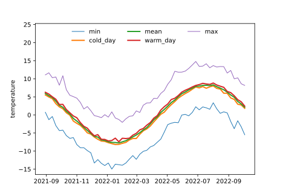

<!-- Python blocks run by tools/python_twins.py (md5 161720bd2aa756952f0eb59071848420). -->

```{r setup, include = FALSE}
knitr::opts_chunk$set(collapse = TRUE, comment = "#>", fig.width = 6.5, fig.height = 4.5,
                      dev.args = list(pointsize = 14))
set.seed(1)
library(timesift)
if (nzchar(Sys.getenv("TIMESIFT_DOCS_CACHE"))) source(Sys.getenv("TIMESIFT_DOCS_CACHE"))
```

Machine learning models need sensor measurements organised into a table. Building that table means choosing how much time each value covers, how to summarise the measurements within that period, and when each period starts. `timesift` lets you specify these choices, builds the model inputs, and saves the choices alongside them.

A time interval is called a *bin*, and its time scale, such as a week or month, is its *grain*. A *representation* is the set of choices used to prepare the model inputs. This article works through those choices, including summary statistics, calendar boundaries, gaps and periods before a survey date.

## Installation

::: {.lang-pair}
```{r, eval = FALSE}
# Install from CRAN
install.packages("timesift")

# Or install the development version from GitHub
# install.packages("pak")
pak::pak("gcol33/timesift")
```

```bash
# Install from PyPI
pip install timesift

# with the torch encoders, the contrasts and the plots
pip install "timesift[torch,contrasts,plot]"

# Or install the development version from GitHub
pip install git+https://github.com/gcol33/timesift
```
:::

## Two tables, and the columns read from them

A run takes two tables linked by a shared identifier. `series` contains one row per sensor reading. `targets` contains one row per observation to predict, such as a species survey on a plot. Here a *unit* is a study plot. The example has thirty plots logged hourly for 400 days from 1 September 2021. Each record includes seasonal and daily cycles, a plot-specific offset and noise.

::: {.lang-pair}
```{r data}
hours <- seq(as.POSIXct("2021-09-01", tz = "UTC"), by = "hour", length.out = 24 * 400)
ids <- sprintf("p%02d", 1:30)
warmth <- rnorm(30)
doy <- as.numeric(format(hours, "%j"))
hod <- as.numeric(format(hours, "%H"))

series <- data.frame(
  plot = rep(ids, each = length(hours)),
  t = rep(hours, times = 30),
  temp = as.numeric(vapply(warmth, function(w) {
    w + 8 * sin(2 * pi * (doy - 110) / 365) + 3 * sin(2 * pi * (hod - 9) / 24) +
      rnorm(length(hours), sd = 1.5)
  }, numeric(length(hours))))
)

targets <- data.frame(plot = ids, elevation = round(2400 - 150 * warmth))
targets[paste0("sp", 1:4)] <- lapply(c(1, -1, 1, -1), function(s) {
  rbinom(30, 1, plogis(2 * s * warmth))
})
str(series)
head(targets, 3)
```

```python
import numpy as np
import pandas as pd
import timesift as ts

rng = np.random.default_rng(1)
hours = pd.date_range("2021-09-01", periods=24 * 400, freq="h")
ids = [f"p{i:02d}" for i in range(1, 31)]
warmth = rng.normal(size=30)
doy = hours.dayofyear.to_numpy()
hod = hours.hour.to_numpy()

series = pd.DataFrame({
    "plot": np.repeat(ids, len(hours)),
    "t": np.tile(hours, 30),
    "temp": np.concatenate([
        w + 8 * np.sin(2 * np.pi * (doy - 110) / 365) + 3 * np.sin(2 * np.pi * (hod - 9) / 24)
        + rng.normal(scale=1.5, size=len(hours)) for w in warmth]),
})

targets = pd.DataFrame({"plot": ids, "elevation": np.round(2400 - 150 * warmth)})
for k, sign in enumerate([1, -1, 1, -1], start=1):
    targets[f"sp{k}"] = rng.binomial(1, 1 / (1 + np.exp(-2 * sign * warmth)))
series.dtypes
#> plot               str
#> t       datetime64[us]
#> temp           float64
#> dtype: object
targets.head(3)
#>   plot  elevation  sp1  sp2  sp3  sp4
#> 0  p01     2348.0    1    0    1    1
#> 1  p02     2277.0    1    0    1    0
#> 2  p03     2350.0    1    1    0    0
```
:::

`grain_matrix()` reads three columns of `series`: the plot identifier (`id`), the time of each reading (`time`) and the measurement (`value`). Supply each column as a bare name or a string. The result is a three-dimensional numeric array, indexed by `[unit, bin, channel]`. Each channel holds one summary statistic, such as the mean temperature. Attributes attached to the array record how it was built.

::: {.lang-pair}
```{r first}
x <- grain_matrix(series, plot, t, temp, grain = "month")
x
dim(x)
names(attributes(x))
```

```python
x = ts.grain_matrix(series, "plot", "t", "temp", grain="month")
x
#> <timesift matrix> 30 units x 14 bins x 1 channels
#> grain: month  stats: mean
#> from  : 2021-09-01T00:00:00Z to 2022-10-01T00:00:00Z
x.shape
#> (30, 14, 1)
list(x.__dataclass_fields__)
#> ['values', 'units', 'bins', 'stats', 'grain', 'year_start', 'bin_start', 'bin_end', 'bin_n', 'bin_partial', 'span', 'lag', 'static', 'position', 'coords', 'unit_ids']
```
:::

The array has thirty plots, fourteen monthly bins covering the 400 days, and one channel for the mean. `bin_start` gives the start of each calendar interval; `bin_end` gives its last recorded reading. `bin_n` counts readings for each plot and bin, and `bin_partial` identifies intervals only partly covered by the record. Bin names use the ISO 8601 date-time format in Coordinated Universal Time (UTC), in both R and Python.

Unit identifiers are treated as names. Text and factor levels keep their labels, and whole numbers are written as digits: `100000` stays `100000`. Rows are sorted by the bytes of their text identifiers, a rule called *C collation*. This gives the same order in both languages and on every machine; for example, `"100000"` sorts before `"7"`.

::: {.lang-pair}
```{r ids}
numeric_ids <- transform(series[series$plot %in% c("p01", "p02"), ],
                         plot = ifelse(plot == "p01", 100000, 7))
dimnames(grain_matrix(numeric_ids, plot, t, temp, grain = "month"))[[1]]
```

```python
numeric_ids = series[series["plot"].isin(["p01", "p02"])].copy()
numeric_ids["plot"] = np.where(numeric_ids["plot"] == "p01", 100000, 7)
ts.grain_matrix(numeric_ids, "plot", "t", "temp", grain="month").units
#> ('100000', '7')
```
:::

A number that is not whole is refused as an identifier, as is a missing value in the unit or the
time column. A unit holding two readings at the same instant is refused as well, with the first
duplicate named, because a reading counted twice would weigh twice in every mean and every daily
extreme it reaches.

::: {.lang-pair}
```{r duplicate, error = TRUE}
grain_matrix(rbind(series[1:5, ], series[3, ]), plot, t, temp, grain = "day")
```

```{.python error=true}
ts.grain_matrix(pd.concat([series.iloc[:5], series.iloc[[2]]]), "plot", "t", "temp", grain="day")
#> ValueError: 1 duplicated (unit, time) pair, first: p01 at 2021-09-01T02:00:00Z.
```
:::

`timesift()` reads the same columns through its own `id` and `time` arguments, and `x` selects
which numeric columns of `series` hold readings; by default every numeric column but the
identifier and the time. Where it selects more than one, each reaches the learner as channels of
its own, named by the column and the statistic, such as `temp_mean` beside `snow_mean`.

### Time zones

`time` must be `POSIXct`. Bins follow the calendar the column is carried in, which is its
`tzone` attribute, and a column without one is read as UTC. The zone is resolved once, as the
column enters the core, and everything below works on the local clock, so a day is a wall-clock
day. In a zone that keeps summer time, the day the clock goes forward holds 23 hourly readings.

::: {.lang-pair}
```{r zones}
spring <- seq(as.POSIXct("2021-03-26", tz = "Europe/Vienna"),
              as.POSIXct("2021-03-30 23:00", tz = "Europe/Vienna"), by = "hour")
vienna <- data.frame(plot = "a", t = spring, temp = seq_along(spring))
attr(grain_matrix(vienna, plot, t, temp, grain = "day"), "bin_n")

fixed <- vienna
attr(fixed$t, "tzone") <- "Etc/GMT-1"
attr(grain_matrix(fixed, plot, t, temp, grain = "day"), "bin_n")

identical(as.numeric(grain_matrix(vienna, plot, t, temp, grain = "native")),
          as.numeric(grain_matrix(fixed, plot, t, temp, grain = "native")))
```

```python
spring = pd.date_range("2021-03-26", "2021-03-30 23:00", freq="h", tz="Europe/Vienna")
vienna = pd.DataFrame({"plot": "a", "t": spring, "temp": np.arange(1, len(spring) + 1)})
ts.grain_matrix(vienna, "plot", "t", "temp", grain="day").bin_n
#> array([[24, 24, 23, 24, 24]], dtype=int32)

fixed = vienna.assign(t=vienna["t"].dt.tz_convert("Etc/GMT-1"))
ts.grain_matrix(fixed, "plot", "t", "temp", grain="day").bin_n
#> array([[24, 24, 24, 24, 23]], dtype=int32)

np.array_equal(ts.grain_matrix(vienna, "plot", "t", "temp", grain="native").values,
               ts.grain_matrix(fixed, "plot", "t", "temp", grain="native").values)
#> True
```
:::

Carried in `"Europe/Vienna"`, 28 March 2021 holds 23 readings, and the bins after it start at
22:00 UTC because local midnight has moved an hour. The same instants carried in `"Etc/GMT-1"`,
the fixed offset of Central European standard time, bin into days of 24 readings; the last day
there holds 23 only because the record stops at 23:00 on the summer clock, which is 22:00 on the
fixed one. Changing the `tzone` attribute changes nothing about the readings, only the calendar
they are binned on. The `native` grain is the one grain not read on a clock: its bin is the
reading itself, so it is the same array in either zone.

A logger that keeps a fixed offset is best carried in that offset. The Schrankogel deposit is
one such record: 26,304 hourly readings that bin into 1,096 days of 24.

## The seven grains

A grain names how much of the record one bin stands for. Naming several at once returns a
`timesift_set`, one array per grain over the same units.

::: {.lang-pair}
```{r ladder}
ladder <- grain_matrix(series, plot, t, temp,
                       grain = c("native", "halfday", "day", "week", "month", "season", "year"))
ladder
```

```python
ladder = ts.grain_matrix(series, "plot", "t", "temp",
                         grain=("native", "halfday", "day", "week", "month", "season", "year"))
ladder
#> <timesift set> 7 grains over 30 units
#>   native      9600 bins x 1 channels (mean)
#>   halfday      800 bins x 1 channels (mean)
#>   day          400 bins x 1 channels (mean)
#>   week          58 bins x 1 channels (mean)
#>   month         14 bins x 1 channels (mean)
#>   season         6 bins x 1 channels (mean)
#>   year           2 bins x 1 channels (mean)
```
:::

`native` is the record unreduced: 9,600 bins of one reading each. `halfday` cuts each calendar day
at noon into 800 bins, and `day` gives 400. The four coarser grains follow the calendar and give
58 weeks, 14 months, 6 seasons and 2 years. None of them is a fixed count of hours.

::: {.lang-pair}
```{r week-start}
week <- ladder[["week"]]
head(attr(week, "bin_start"), 3)
format(head(attr(week, "bin_start"), 3), "%A")
attr(ladder[["month"]], "bin_n")[1, ]
```

```python
week = ladder["week"]
week.bin_start[:3]
#> array(['2021-08-30T00:00:00', '2021-09-06T00:00:00',
#>        '2021-09-13T00:00:00'], dtype='datetime64[s]')
pd.Series(week.bin_start[:3]).dt.day_name().tolist()
#> ['Monday', 'Monday', 'Monday']
ladder["month"].bin_n[0]
#> array([720, 744, 720, 744, 744, 672, 744, 720, 744, 720, 744, 744, 720,
#>        120], dtype=int32)
```
:::

A week is an ISO week, Monday to Sunday, so the first weekly bin begins on Monday 30 August 2021
although the record begins on the Wednesday after it. A month is a calendar month: the counts run
720, 744 and 672 readings for months of 30, 31 and 28 days, and the last month holds 120 readings
because the record stops five days into October 2022.

### Where the year begins

`season` and `year` are counted from `year_start`, a `"MM-DD"` boundary that defaults to the
calendar year. A season is three calendar months counted from that boundary, so the default gives
the quarters January to March, April to June and so on. A hydrological year starting in September
is `"09-01"`, and it moves the seasons with it.

::: {.lang-pair}
```{r year-start}
hydro <- grain_matrix(series, plot, t, temp, grain = c("season", "year"), year_start = "09-01")
attr(hydro[["season"]], "bin_start")
attr(hydro[["year"]], "bin_n")[1, ]
attr(ladder[["year"]], "bin_n")[1, ]
```

```python
hydro = ts.grain_matrix(series, "plot", "t", "temp", grain=("season", "year"), year_start="09-01")
hydro["season"].bin_start
#> array(['2021-09-01T00:00:00', '2021-12-01T00:00:00',
#>        '2022-03-01T00:00:00', '2022-06-01T00:00:00',
#>        '2022-09-01T00:00:00'], dtype='datetime64[s]')
hydro["year"].bin_n[0]
#> array([8760,  840], dtype=int32)
ladder["year"].bin_n[0]
#> array([2928, 6672], dtype=int32)
```
:::

On the September boundary the record is five seasons and two years, of 8,760 and 840 readings. On
the default boundary the same record splits into calendar years of 2,928 and 6,672 readings. Which
boundary fits is a question about the system. The Schrankogel deposit uses a hydrological year from
1 September, and on the calendar year each of its winters falls into two bins.

## Statistics

Each bin is summarised by one or more statistics, one channel each, in the order they are named.
Seven exist, and they fall into two families. `mean`, `min` and `max` act on the readings of the
bin directly. The four day-level statistics first reduce each calendar day of the bin and then
reduce again over the days: `cold_day` and `warm_day` are the coldest and warmest daily mean, and
`mean_daily_min` and `mean_daily_max` are the bin's average daily minimum and maximum.

::: {.lang-pair}
```{r stats}
stats7 <- c("min", "mean_daily_min", "cold_day", "mean", "warm_day", "mean_daily_max", "max")
m <- grain_matrix(series, plot, t, temp, grain = "month", stats = stats7)
round(m["p01", 1:3, ], 2)
```

```python
stats7 = ("min", "mean_daily_min", "cold_day", "mean", "warm_day", "mean_daily_max", "max")
m = ts.grain_matrix(series, "plot", "t", "temp", grain="month", stats=stats7)
pd.DataFrame(m.values[0, :3, :].T, index=m.stats, columns=[b[:10] for b in m.bins[:3]]).round(2)
#>                 2021-09-01  2021-10-01  2021-11-01
#> min                  -4.33       -6.47      -10.47
#> mean_daily_min       -0.13       -4.15       -7.87
#> cold_day              2.81       -1.69       -5.31
#> mean                  4.63        0.78       -3.13
#> warm_day              6.27        2.92       -0.78
#> mean_daily_max        9.33        5.72        1.66
#> max                  11.65       10.85        4.64
```
:::

Within every bin the two families order themselves around the mean: `min` sits below
`mean_daily_min`, which sits below `mean`, and `min` sits below `cold_day` likewise. In
September 2021 plot `p01` read a coldest hour of [-4.61]{.lang-r-only}[-4.33]{.lang-py-only py="format(m.values[0, 0, 0], '.2f')"},
an average daily minimum of [-1.07]{.lang-r-only}[-0.13]{.lang-py-only py="format(m.values[0, 0, 1], '.2f')"} and a coldest day of
[1.88]{.lang-r-only}[2.81]{.lang-py-only py="format(m.values[0, 0, 2], '.2f')"}, against a mean of [3.72]{.lang-r-only}[4.63]{.lang-py-only py="format(m.values[0, 0, 3], '.2f')"}. The figure lays the weekly versions of five of them
over the whole record.

::: {.lang-pair}
```{r weekly-figure, fig.alt = "Weekly minimum, coldest day, mean, warmest day and maximum of one plot over 400 days, the day-level pair lying inside the reading-level pair."}
wk7 <- grain_matrix(series, plot, t, temp, grain = "week", stats = stats7)
start <- as.Date(attr(wk7, "bin_start"))
shown <- c("min", "cold_day", "mean", "warm_day", "max")
matplot(start, wk7["p01", , shown], type = "l", lty = 1, lwd = c(1, 2, 2, 2, 1),
        col = c("grey60", "steelblue", "black", "firebrick", "grey60"),
        xaxt = "n", xlab = "", ylab = "temperature",
        ylim = range(wk7["p01", , shown]) + c(0, 9))
axis.Date(1, start)
legend("top", legend = shown, lty = 1, lwd = c(1, 2, 2, 2, 1), ncol = 3, bty = "n",
       col = c("grey60", "steelblue", "black", "firebrick", "grey60"))
```

```{.python fig-alt="Weekly minimum, coldest day, mean, warmest day and maximum of one plot over 400 days, the day-level pair lying inside the reading-level pair."}
import matplotlib.pyplot as plt

wk7 = ts.grain_matrix(series, "plot", "t", "temp", grain="week", stats=stats7)
start = wk7.bin_start.astype("datetime64[D]")
shown = ["min", "cold_day", "mean", "warm_day", "max"]
fig, ax = plt.subplots(figsize=(6.5, 4.5))
for stat, lw in zip(shown, [1, 2, 2, 2, 1]):
    ax.plot(start, wk7.values[0, :, wk7.stats.index(stat)], lw=lw, label=stat)
ax.set_ylabel("temperature");
ax.set_ylim(top=ax.get_ylim()[1] + 9);
ax.legend(loc="upper center", ncol=3, frameon=False);
```


:::

### An extreme hour and an extreme day

`min` is set by a single reading, and a single reading can be a sensor touching a cold stone, a
logger dug up by an animal, or one cold hour before dawn. A day-level statistic reaches that hour
only through its share of that day. The next chunk copies September 2021 of plot `p01` and makes
its coldest hour 20 degrees colder, then reduces both copies.

::: {.lang-pair}
```{r spike}
one <- series[series$plot == "p01" & series$t < as.POSIXct("2021-10-01", tz = "UTC"), ]
spiked <- one
cold <- which.min(spiked$temp)
spiked$temp[cold] <- spiked$temp[cold] - 20

both <- rbind(transform(one, plot = "as recorded"), transform(spiked, plot = "one hour colder"))
round(grain_matrix(both, plot, t, temp, grain = "month", stats = stats7)[, 1, ], 2)
```

```python
one = series[(series["plot"] == "p01") & (series["t"] < "2021-10-01")]
spiked = one.copy()
cold = spiked["temp"].idxmin()
spiked.loc[cold, "temp"] -= 20

both = pd.concat([one.assign(plot="as recorded"), spiked.assign(plot="one hour colder")])
sp = ts.grain_matrix(both, "plot", "t", "temp", grain="month", stats=stats7)
pd.DataFrame(sp.values[:, 0, :].T, index=sp.stats, columns=sp.units).round(2)
#>                 as recorded  one hour colder
#> min                   -4.33           -24.33
#> mean_daily_min        -0.13            -0.79
#> cold_day               2.81             2.01
#> mean                   4.63             4.60
#> warm_day               6.27             6.27
#> mean_daily_max         9.33             9.33
#> max                   11.65            11.65
```
:::

`min` follows the hour all the way, from [-4.61]{.lang-r-only}[-4.33]{.lang-py-only py="format(sp.values[0, 0, 0], '.2f')"} to [-24.61]{.lang-r-only}[-24.33]{.lang-py-only py="format(sp.values[1, 0, 0], '.2f')"}. `cold_day` moves from
[1.88]{.lang-r-only}[2.81]{.lang-py-only py="format(sp.values[0, 0, 2], '.2f')"} to [1.05]{.lang-r-only}[2.01]{.lang-py-only py="format(sp.values[1, 0, 2], '.2f')"}, [which is the 20 degrees divided over the 24 readings of the day
the hour fell on]{.lang-r-only}[a shift of ]{.lang-py-only}[0.80]{.lang-py-only py="format(abs(sp.values[1, 0, 2] - sp.values[0, 0, 2]), '.2f')"}[, against the ]{.lang-py-only}[0.83]{.lang-py-only py="format(20 / 24, '.2f')"}[ of the 20 degrees divided over the 24 readings of the day the hour fell on, because a different day can become the coldest]{.lang-py-only}. `mean_daily_min` moves from [-1.07]{.lang-r-only}[-0.13]{.lang-py-only py="format(sp.values[0, 0, 1], '.2f')"} to [-1.74]{.lang-r-only}[-0.79]{.lang-py-only py="format(sp.values[1, 0, 1], '.2f')"}, the 20 degrees
divided over the 30 daily minima of the month, and the mean moves by
[0.03]{.lang-r-only}[0.03]{.lang-py-only py="format(abs(sp.values[1, 0, 3] - sp.values[0, 0, 3]), '.2f')"}. The warm side does not move at all. An extreme day is a state
the unit was in for a whole day; an extreme reading can be one hour.

Where the record is clean, the two still carry different things. In the Schrankogel study a
window's coldest and warmest day carried more than its mean, and more the wider the window: the
gain from adding them grew from 0.006 TSS at a weekly grain to 0.046 at a yearly one.

The day-level statistics need whole days inside a bin, so they are refused at `native` and
`halfday` before any record is read. At `day` they are allowed and coincide with the reading-level
ones: a bin of one day has one daily mean and one daily minimum.

::: {.lang-pair}
```{r day-only, error = TRUE}
grain_matrix(series, plot, t, temp, grain = "halfday", stats = "cold_day")
```

```{.python error=true}
ts.grain_matrix(series, "plot", "t", "temp", grain="halfday", stats="cold_day")
#> ValueError: `halfday` bins are shorter than a day, so cold_day is not defined there. Use a grain of `day` or coarser.
```
:::

::: {.lang-pair}
```{r at-day}
d <- grain_matrix(series, plot, t, temp, grain = "day",
                  stats = c("mean", "cold_day", "min", "mean_daily_min"))
round(d["p01", 1:2, ], 2)
```

```python
d = ts.grain_matrix(series, "plot", "t", "temp", grain="day",
                    stats=("mean", "cold_day", "min", "mean_daily_min"))
pd.DataFrame(d.values[0, :2, :], index=d.bins[:2], columns=d.stats).round(2)
#>                       mean  cold_day   min  mean_daily_min
#> 2021-09-01T00:00:00Z  6.27      6.27  2.01            2.01
#> 2021-09-02T00:00:00Z  5.99      5.99  1.41            1.41
```
:::

## A calendar passed as a function

To define a custom calendar, pass `grain` a function that returns the start of the bin containing each reading. The example uses fixed dates close to the solstices and equinoxes: 21 March, 21 June, 23 September and 21 December.

::: {.lang-pair}
```{r solstices}
solstice_seasons <- function(when) {
  md <- format(when, "%m-%d", tz = "UTC")
  y <- as.integer(format(when, "%Y", tz = "UTC"))
  k <- (md >= "03-21") + (md >= "06-21") + (md >= "09-23") + (md >= "12-21")
  start <- c("12-21", "03-21", "06-21", "09-23", "12-21")[k + 1L]
  as.POSIXct(paste0(ifelse(k == 0L, y - 1L, y), "-", start), tz = "UTC")
}
s <- grain_matrix(series, plot, t, temp, grain = solstice_seasons,
                  stats = c("cold_day", "mean", "warm_day"))
s
attr(s, "bin_n")[1, ]
attr(s, "bin_partial")
```

```python
def solstice_seasons(when):
    when = pd.DatetimeIndex(when)
    md = when.strftime("%m-%d").to_numpy()
    k = (md >= "03-21").astype(int) + (md >= "06-21") + (md >= "09-23") + (md >= "12-21")
    start = np.array(["12-21", "03-21", "06-21", "09-23", "12-21"])[k]
    year = np.where(k == 0, when.year - 1, when.year)
    return pd.to_datetime([f"{y}-{s}" for y, s in zip(year, start)])

s = ts.grain_matrix(series, "plot", "t", "temp", grain=solstice_seasons,
                    stats=("cold_day", "mean", "warm_day"))
s
#> <timesift matrix> 30 units x 6 bins x 3 channels
#> grain: custom  stats: cold_day, mean, warm_day
#> from  : 2021-06-21T00:00:00Z to 2022-09-23T00:00:00Z
s.bin_n[0]
#> array([ 528, 2136, 2160, 2208, 2256,  312], dtype=int32)
s.bin_partial
#> array([ True, False, False, False, False, False])
```
:::

The array is the same shape as any other and is reported under the grain `custom`. The first bin
opens on 21 June 2021 and holds the 528 readings from the record's start to 23 September, so it is
marked partial. The last bin holds 312 readings and is not: a supplied calendar declares where its
bins begin but not where the last one was meant to end, so the record's end is taken as its end.
Day-level statistics are allowed on a supplied calendar as long as no bin boundary cuts through a
day, and a calendar that does cut one is refused with the day named.

The Schrankogel study's seasonal rung was of this kind, and its reproduction driver passes the
deposit's astronomical seasons the same way.

## Gaps

Every unit must have at least one reading in every bin. `grain_matrix()` raises an error for an empty bin. In this example, plot `p07` is missing the calendar week starting Monday 7 February 2022.

::: {.lang-pair}
```{r gap, error = TRUE}
lost <- series$plot == "p07" &
  series$t >= as.POSIXct("2022-02-07", tz = "UTC") &
  series$t < as.POSIXct("2022-02-14", tz = "UTC")
gappy <- series[!lost, ]
grain_matrix(gappy, plot, t, temp, grain = "week")
```

```{.python error=true}
lost = ((series["plot"] == "p07") & (series["t"] >= "2022-02-07") & (series["t"] < "2022-02-14"))
gappy = series[~lost]
ts.grain_matrix(gappy, "plot", "t", "temp", grain="week")
#> ValueError: 1 (unit, bin) cell holds no readings, first: unit p07 at 2022-02-07T00:00:00. Every unit must span every bin; gaps are not padded. coverage() lists them.
```
:::

`coverage()` counts readings for each unit and bin, so you can locate gaps before building a representation. Supply the unit and time columns and the grain; the function only needs timestamps to count readings.

::: {.lang-pair}
```{r coverage}
cv_week <- coverage(gappy, plot, t, grain = "week")
cv_week
cv_week["p07", 22:26]
coverage(gappy, plot, t, grain = "month")
```

```python
cv_week = ts.coverage(gappy, "plot", "t", grain="week")
cv_week
#> <timesift coverage> 30 units x 58 bins at the week grain
#> 1 empty (unit, bin) cells in 1 units: p07
p07 = cv_week.units.index("p07")
pd.Series(cv_week.count[p07, 21:26], index=cv_week.bins[21:26])
#> 2022-01-24T00:00:00Z    168
#> 2022-01-31T00:00:00Z    168
#> 2022-02-07T00:00:00Z      0
#> 2022-02-14T00:00:00Z    168
#> 2022-02-21T00:00:00Z    168
#> dtype: int32
ts.coverage(gappy, "plot", "t", grain="month")
#> <timesift coverage> 30 units x 14 bins at the month grain
#> every unit reaches every bin
```
:::

At the weekly grain the table holds one empty cell, in the week of 7 February. At the monthly
grain every unit reaches every bin, because the lost week sits inside February and February still
holds three weeks of `p07`'s readings.

::: {.lang-pair}
```{r gap-month}
attr(grain_matrix(gappy, plot, t, temp, grain = "month"), "bin_n")[c("p06", "p07"), 5:7]
```

```python
gm = ts.grain_matrix(gappy, "plot", "t", "temp", grain="month")
pd.DataFrame(gm.bin_n, index=gm.units, columns=gm.bins).loc[["p06", "p07"]].iloc[:, 4:7]
#>      2022-01-01T00:00:00Z  2022-02-01T00:00:00Z  2022-03-01T00:00:00Z
#> p06                   744                   672                   744
#> p07                   744                   504                   744
```
:::

Plot `p07`'s February mean uses 504 readings; the other plots use 672. You can handle a gap by choosing a coarser grain with readings in every bin, excluding incomplete units, or restricting the analysis period to the dates all units cover. Use `coverage()` to assess these options. Imputation, if appropriate for the analysis, must be done before calling timesift.

A bin that no unit reaches is caught by a second rule: consecutive bins must be one bin apart on
the grain's own calendar. A month missing from every logger would otherwise pass as thirteen
adjacent monthly bins, and a convolution would read January and March as neighbours. `native` and
a supplied calendar are exempt from that rule, since the first has no calendar step and the second
declares its own.

## Partial bins

A bin is partial when the record does not cover its whole calendar span, which happens only at
the two ends of the record. Which bins those are follows from where the record starts and stops
against the calendar.

::: {.lang-pair}
```{r partial}
attr(ladder[["week"]], "bin_partial")[c(1:2, 57:58)]
which(attr(ladder[["month"]], "bin_partial"))
which(attr(ladder[["season"]], "bin_partial"))
dropped <- grain_matrix(series, plot, t, temp, grain = "month", partial = "drop")
dim(dropped)
```

```python
ladder["week"].bin_partial[[0, 1, 56, 57]]
#> array([ True, False, False,  True])
np.flatnonzero(ladder["month"].bin_partial)
#> array([13])
np.flatnonzero(ladder["season"].bin_partial)
#> array([0, 5])
dropped = ts.grain_matrix(series, "plot", "t", "temp", grain="month", partial="drop")
dropped.shape
#> (30, 13, 1)
```
:::

The record starts on a Wednesday, so the first and last weeks are partial. It starts on the first
of a month, so only the last month, five days of October 2022, is partial. On the default year the
first season opens on 1 July and the last on 1 October, so both are partial too. `bin_partial` is
returned whichever way `partial` is set, so a partial bin that is kept is labelled.

`partial = "keep"`, the default, keeps those bins; `partial = "drop"` removes them, which leaves 13
monthly bins here, and refuses if nothing would be left. Keeping costs a bin whose mean is taken
over fewer readings and whose `cold_day` and `warm_day` are drawn from fewer days, so they sit
closer to the bin's mean than a full bin's would. Dropping costs the ends of the record, up to
three months at each end on a seasonal grain. `timesift()` builds its representations with partial
bins kept.

## Representations as settings

`grain_matrix()` builds an array from a record. A representation describes the array before any
record has been read, so that one object can configure a run, name the candidates it produced, and
rebuild itself for new targets at prediction. There are four constructors.

::: {.lang-pair}
```{r constructors}
native()
grain("week", stats = c("cold_day", "mean", "warm_day"))
multigrain(c("month", "season"), stats = c("min", "mean", "max"))
lookback("28 days", bins = 4)
lookback("90 days", lag = "30 days")
```

```python
ts.native()
#> <timesift representation> native
#> kind    : grain (a sequence)
#> grain   : native
#> stats   : mean
ts.grain("week", stats=("cold_day", "mean", "warm_day"))
#> <timesift representation> week
#> kind    : grain (a sequence)
#> grain   : week
#> stats   : cold_day, mean, warm_day
ts.multigrain(("month", "season"), stats=("min", "mean", "max"))
#> <timesift representation> multigrain(month+season)
#> kind    : multigrain (a block of features)
#> grains  : month, season
#> stats   : min, mean, max
ts.lookback("28 days", bins=4)
#> <timesift representation> 28 days x4
#> kind    : lookback (a sequence)
#> span    : 28 days in 4 bins ending 0 days before the target
#> stats   : mean
ts.lookback("90 days", lag="30 days")
#> <timesift representation> 90 days lag 30 days
#> kind    : lookback (a block of features)
#> span    : 90 days in 1 bin ending 30 days before the target
#> stats   : mean
```
:::

`native()` is `grain("native")`. `grain()` takes one grain name or one calendar function, its
statistics and its `year_start`. `multigrain()` builds several grains and flattens each into one
row per target, side by side, so a column names the grain, the statistic and the bin it came from;
with `grains = NULL` it takes every grain the record supports. `lookback()` reads a fixed span
ending a fixed lag before each target's own instant, cut into `bins` sub-bins.

Each printout says whether the representation is a sequence or a block of features. `native()`,
`grain()` and a lookback of more than one bin are sequences, whose bins are ordered in time and
mean something to a convolution; `multigrain()` and a one-bin lookback are blocks. A learner
declares which it reads, and that decides which pairs a run fits.

The constructors check what they can without a record. A day-level statistic at a sub-day grain is
refused at construction, as are an unknown grain, a duplicated statistic and a malformed
`year_start`.

### Sets of them

`grains()` and `lookbacks()` build sets, which is what a run's `sift` takes. Their arguments are
separate names or one vector, and the settings after them apply to every member.

::: {.lang-pair}
```{r sets}
grains("day", "week", "month")
grains(c("month", "year"), stats = c("cold_day", "mean", "warm_day"))
grains("auto")
lookbacks("28 days", "84 days", bins = 4)
c(grain("week"), multigrain(c("month", "season")))
```

```python
ts.grains("day", "week", "month")
#> <timesift sift> 3 representations
#>   day            grain
#>   week           grain
#>   month          grain
ts.grains(("month", "year"), stats=("cold_day", "mean", "warm_day"))
#> <timesift sift> 2 representations
#>   month          grain
#>   year           grain
ts.grains("auto")
#> <timesift sift> 1 representations
#>   auto           auto
ts.lookbacks("28 days", "84 days", bins=4)
#> <timesift sift> 2 representations
#>   28 days x4     lookback
#>   84 days x4     lookback
ts.as_sift([ts.grain("week"), ts.multigrain(("month", "season"))])
#> <timesift sift> 2 representations
#>   week           grain
#>   multigrain(month+season) multigrain
```
:::

A set is labelled by each member's own label, and two members that would share a label are
refused unless the list is named. `grains("auto")` stands for every named grain the record gives
at least two bins, in order from `native` to `year`, leaving out any grain the requested statistics
are not defined at. It is resolved when a record is read, which is why its printout names the
statistics and no grains, and why it cannot be combined with named grains through `c()`. There is
no cap on it: on this record it includes `native` at 9,600 bins.

## Lookbacks: several targets on one unit

A calendar grain gives every unit one row. Where a unit carries several targets through time,
such as a plot surveyed in May and again in July, each target needs the record leading up to its
own instant. `lookback_matrix()` reads, for every target, a fixed span ending a fixed lag before
that target's instant. `at` is a data frame with an `id` column naming the unit and an `at` column
of instants.

::: {.lang-r-only}
Its row names name the targets.
:::

::: {.lang-py-only}
The targets are named by their position in `at`, counted from 1.
:::

::: {.lang-pair}
```{r lookback}
visits <- data.frame(id = c("p01", "p01", "p02"),
                     at = as.POSIXct(c("2022-05-01", "2022-07-01", "2022-07-01"), tz = "UTC"))
rownames(visits) <- c("p01-may", "p01-jul", "p02-jul")
lb <- lookback_matrix(series, plot, t, temp, at = visits, span = "28 days", bins = 4,
                      stats = c("cold_day", "mean", "warm_day"))
lb
dimnames(lb)[[2]]
round(lb[, , "mean"], 2)
```

```python
visits = pd.DataFrame({"id": ["p01", "p01", "p02"],
                       "at": pd.to_datetime(["2022-05-01", "2022-07-01", "2022-07-01"])})
lb = ts.lookback_matrix(series, "plot", "t", "temp", at=visits, span="28 days", bins=4,
                        stats=("cold_day", "mean", "warm_day"))
lb
#> <timesift matrix> 3 targets x 4 bins x 3 channels
#> grain: lookback  stats: cold_day, mean, warm_day
#> from  : -28 days to -7 days
lb.bins
#> ('-28 days', '-21 days', '-14 days', '-7 days')
pd.DataFrame(lb.channel("mean"), index=lb.units, columns=lb.bins).round(2)
#>    -28 days  -21 days  -14 days  -7 days
#> 1     -1.45     -0.69      0.50     1.45
#> 2      6.16      6.70      7.19     7.76
#> 3      6.76      7.17      7.71     8.04
```
:::

The rows are the three targets in `at`'s own order, two of them on plot `p01`. The four bins are
named by where each opens relative to the anchor, oldest first, so the columns line up across
targets that share no calendar date. The weekly means before the May visit to `p01` rise from
[-2.43]{.lang-r-only}[-1.45]{.lang-py-only py="format(lb.channel('mean')[0, 0], '.2f')"} to [0.42]{.lang-r-only}[1.45]{.lang-py-only py="format(lb.channel('mean')[0, 3], '.2f')"}; before the July visits they rise from
[5.36]{.lang-r-only}[6.16]{.lang-py-only py="format(lb.channel('mean')[1, 0], '.2f')"} to [6.65]{.lang-r-only}[7.76]{.lang-py-only py="format(lb.channel('mean')[1, 3], '.2f')"} on `p01` and from [6.08]{.lang-r-only}[6.76]{.lang-py-only py="format(lb.channel('mean')[2, 0], '.2f')"} to [7.82]{.lang-r-only}[8.04]{.lang-py-only py="format(lb.channel('mean')[2, 3], '.2f')"}
on `p02`.

A lookback measures fixed lengths: a month is 30 days and a year 365 there, since every target has
to read the same amount of record for the rows to be comparable. Where the calendar matters,
`grain_matrix()` is the call that follows it. The day-level statistics need each bin to be a whole
number of days and to start on a day boundary, which the anchors at midnight above satisfy.

Every target and bin must hold at least one reading. A bin lying entirely before the start of the
record is refused, with the target and the interval named.

::: {.lang-pair}
```{r lookback-edge, error = TRUE}
early <- data.frame(id = "p01", at = as.POSIXct("2021-09-15", tz = "UTC"))
lookback_matrix(series, plot, t, temp, at = early, span = "28 days", bins = 4)
```

```{.python error=true}
early = pd.DataFrame({"id": ["p01"], "at": pd.to_datetime(["2021-09-15"])})
ts.lookback_matrix(series, "plot", "t", "temp", at=early, span="28 days", bins=4)
#> ValueError: 2 (target, bin) cells hold no readings, first: target 1 over [2021-08-18T00:00:00, 2021-08-25T00:00:00). A lookback reaching past the record is not padded.
```
:::

The target on 15 September asks for four weeks from 18 August, and the record begins on
1 September, so the first two weeks of the lookback hold nothing. `bin_n` on a lookback, as on a
grain, gives the number of readings each cell was reduced from, and is worth reading where an
anchor sits near either end of the record.

## The position of a bin in the year

Some neural networks average their internal values across time, an operation called *global pooling*. To let these networks distinguish the season of an event, `calendar_channels()` supplies the position of each bin within the year. It represents that position with a sine and cosine pair calculated at the midpoint of the readings in the bin. `bind_channels()` adds these values alongside the measurements.

::: {.lang-pair}
```{r channels}
wk <- grain_matrix(series, plot, t, temp, grain = "week", stats = c("cold_day", "mean", "warm_day"))
pos <- calendar_channels(wk)
round(pos["p01", 1:4, ], 3)
both_wk <- bind_channels(wk, pos)
dimnames(both_wk)[[3]]
attr(both_wk, "position")
```

```python
wk = ts.grain_matrix(series, "plot", "t", "temp", grain="week",
                     stats=("cold_day", "mean", "warm_day"))
pos = ts.calendar_channels(wk)
pd.DataFrame(pos.values[0, :4, :], index=pos.bins[:4], columns=pos.stats).round(3)
#>                       year_sin  year_cos
#> 2021-08-30T00:00:00Z    -0.876    -0.483
#> 2021-09-06T00:00:00Z    -0.927    -0.374
#> 2021-09-13T00:00:00Z    -0.966    -0.260
#> 2021-09-20T00:00:00Z    -0.990    -0.142
both_wk = ts.bind_channels(wk, pos)
both_wk.stats
#> ('cold_day', 'mean', 'warm_day', 'year_sin', 'year_cos')
both_wk.position
#> ('year_sin', 'year_cos')
```
:::

The two channels have the same values for every unit. The sine and cosine vary continuously across the end of the year. Their `position` attribute tells the torch networks to use these values at their original scale.

On a grain finer than a day, `cycles = "day"` adds the place in the daily cycle as a second pair.
At a day or coarser every bin would sit at the same place in the day, and that cycle is refused.

::: {.lang-pair}
```{r channels-day}
hd <- ladder[["halfday"]]
round(calendar_channels(hd, cycles = c("year", "day"))["p01", 1:4, ], 3)
```

```python
hd = ladder["halfday"]
cc = ts.calendar_channels(hd, cycles=("year", "day"))
pd.DataFrame(cc.values[0, :4, :], index=cc.bins[:4], columns=cc.stats).round(3)
#>                       year_sin  year_cos  day_sin  day_cos
#> 2021-09-01T00:00:00Z    -0.865    -0.502    0.991    0.131
#> 2021-09-01T12:00:00Z    -0.869    -0.494   -0.991   -0.131
#> 2021-09-02T00:00:00Z    -0.874    -0.487    0.991    0.131
#> 2021-09-02T12:00:00Z    -0.878    -0.479   -0.991   -0.131
```
:::

The two halves of each day alternate in sign on the daily pair, since the readings of one are
centred on 05:30 and those of the other on 17:30. A lookback has no place in the calendar, its
bins being placed relative to each target, and is refused.

::: {.lang-pair}
```{r channels-lookback, error = TRUE}
calendar_channels(lb)
```

```{.python error=true}
ts.calendar_channels(lb)
#> ValueError: a lookback's bins are placed relative to a target rather than on the calendar, so they have no position in the year. calendar_channels() reads a grain_matrix().
```
:::

`bind_channels()` takes any number of arrays over the same units and bins, keeps the first one's
attributes and joins their channel names. Two channels of the same name are refused. It is also
how a second variable, such as a snow product binned to the same grain, joins the temperature.

## The tabular layout

A sequence learner reads the array as it is. A tabular learner, such as `elasticnet()` or
`forest()`, reads a matrix with one row per unit and one column per predictor. `as.matrix()` on a
representation gives that layout, channel by channel and bin by bin within each.

::: {.lang-pair}
```{r as-matrix}
tab <- as.matrix(grain_matrix(series, plot, t, temp, grain = "season", stats = c("min", "max")))
dim(tab)
colnames(tab)
```

```python
tab = ts.flatten(ts.grain_matrix(series, "plot", "t", "temp", grain="season", stats=("min", "max")))
tab.shape
#> (30, 12)
```
:::

Two statistics over six seasons give twelve columns.

::: {.lang-r-only}
Each is named `channel@bin`.
:::

::: {.lang-py-only}
`ts.flatten()` is the Python counterpart of `as.matrix()` and returns the array without column names, in the same order.
:::

A channel that holds the same number in every bin, as a `static` predictor such as elevation does
inside a run, becomes a single column, so a penalised fit sees it once rather than once per bin.
This is the function to call inside a learner of one's own that reads a block.

::: {.lang-r-only}
That column is named by the channel alone.
:::

`feature_matrix()` goes the other way: it turns a table already reduced elsewhere, such as a set
of published bioclimatic summaries, into a `[unit, feature, 1]` array a learner reads like any
other. Units come from the row names or from a leading text column.

::: {.lang-pair}
```{r feature-matrix}
bio <- data.frame(plot = ids, gdd = round(rnorm(30, 900, 80)), frost_days = rpois(30, 40))
fm <- feature_matrix(bio, label = "bioclim")
fm
head(as.matrix(fm), 3)
```

```python
bio = pd.DataFrame({"plot": ids, "gdd": np.round(rng.normal(900, 80, 30)),
                    "frost_days": rng.poisson(40, 30)})
fm = ts.feature_matrix(bio[["gdd", "frost_days"]], units=bio["plot"],
                       features=["gdd", "frost_days"], label="bioclim")
fm
#> <timesift matrix> 30 units x 2 bins x 1 channels
#> grain: bioclim  stats: bioclim
#> from  : gdd to frost_days
ts.flatten(fm)[:3]
#> array([[895.,  47.],
#>        [962.,  49.],
#>        [759.,  41.]])
```
:::

Each feature is a bin of the one channel, which is why the printout counts two bins. A feature
table carries no time axis, because its reduction has already happened, and that is what makes it
the comparison a grain is measured against.

## Sets of built arrays

`timesift_set()` holds several built arrays over the same targets, keyed by label. It is what
`grain_matrix()` returns for several grains, what `grain_ladder()` fits across, and what a fitted
run keeps as its representations. A grain, a supplied calendar and a feature table can be members
of one set.

::: {.lang-pair}
```{r set}
set <- timesift_set(list(week = wk, season = s, bioclim = fm))
set
set[c("week", "bioclim")]
```

```python
members = ts.timesift_set({"week": wk, "season": s, "bioclim": fm})
members
#> <timesift set> 3 grains over 30 units
#>   week          58 bins x 3 channels (cold_day, mean, warm_day)
#>   season         6 bins x 3 channels (cold_day, mean, warm_day)
#>   bioclim        2 bins x 1 channels (bioclim)
ts.timesift_set({k: members[k] for k in ("week", "bioclim")})
#> <timesift set> 2 grains over 30 units
#>   week          58 bins x 3 channels (cold_day, mean, warm_day)
#>   bioclim        2 bins x 1 channels (bioclim)
```
:::

Every member must cover the same targets in the same order, which is checked on the row names. The
lookback above covers three targets where the weekly array covers thirty plots, so the two cannot
share a set.

::: {.lang-pair}
```{r set-mismatch, error = TRUE}
timesift_set(list(week = wk, visits = lb))
```

```{.python error=true}
ts.timesift_set({"week": wk, "visits": lb})
#> ValueError: every grain in a set must cover the same units; visits does not
```
:::

## Digests and the artifacts that cross languages

A *digest* is a short string used to compare the contents of arrays. `digest_array()` calculates an MD5 digest after writing every value to twelve decimal places, with units varying fastest, then bins, then channels, and line feeds between values. The format is defined in `inst/spec/representation.md`. R and Python use the same format, and tests compare their digests with saved expected results.

::: {.lang-pair}
```{r digest}
digest_array(ladder[["month"]])
digest_array(grain_matrix(series, plot, t, temp, grain = "month"))
```

```python
ts.digest_array(ladder["month"])
#> 7cd8b7dd8e20b58b4f4b6ea682c1c459
ts.digest_array(ts.grain_matrix(series, "plot", "t", "temp", grain="month"))
#> 7cd8b7dd8e20b58b4f4b6ea682c1c459
```
:::

The month built as part of the seven-grain set and the month built on its own give the same
digest, so they are the same representation to the twelfth decimal place. Comparing two digests
is a quick way to check that a representation built on another machine, in another session or in
Python is the one expected.

R and Python rebuild the model inputs using the same compiled code. To use identical training and test splits, save the fold assignments, observed responses and eligible response-fold pairs in one language and read them in the other. The same random seed can produce different splits in R and Python. `write_folds()`, `read_folds()` and the corresponding response and cell functions use a shared CSV format with line-feed endings and identifiers sorted by C collation.

::: {.lang-pair}
```{r artifacts}
y <- as.matrix(targets[paste0("sp", 1:4)])
rownames(y) <- targets$plot
f <- fold_map(y, v = 3)
path <- tempfile(fileext = ".csv")
write_folds(f, path)
readLines(path, n = 4)
back <- read_folds(path, names(f))
identical(as.integer(back), as.integer(f)) && identical(names(back), names(f))
unlink(path)
```

```python
import tempfile
from pathlib import Path

y = ts.as_response({"id": ids, **{f"sp{k}": targets[f"sp{k}"] for k in range(1, 5)}})
f = ts.fold_map(y, v=3)
path = Path(tempfile.mkdtemp()) / "folds.csv"
ts.write_folds(f, path);
path.read_text().splitlines()[:4]
#> ['id,fold', 'p01,1', 'p02,2', 'p03,1']
back = ts.read_folds(path, f.units)
bool((back.fold == f.fold).all() and back.units == f.units)
#> True
path.unlink()
```
:::

`read_folds()` aligns by name, never by position: `units` gives the order wanted, a unit the file
lacks is an error, and a unit the file carries beyond them is dropped.

## Into a run

A run reaches the representations through two arguments. `sift` in `timesift()` is the set every
learner without a representation of its own is fitted across, and `data =` on a learner pins that
learner to one representation. The run below uses `grains("auto")` for the default learner and
pins a second elastic net to a `multigrain()` block. It compares the candidates on three folds and
skips the nested estimate and the stack, which keeps it fast.

::: {.lang-pair}
```{r run}
fit <- timesift(targets, series, y = starts_with("sp"), id = plot, time = t,
                learners = list(elasticnet = elasticnet(),
                                pinned = elasticnet(data = multigrain(c("month", "season")))),
                sift = grains("auto"), resampling = cv(v = 3), n_inner = NULL,
                ensemble = FALSE, verbose = FALSE)
fit$candidates[c("candidate", "representation", "bins", "channels", "status")]
```

```python
fit = ts.timesift(targets, series, y="sp*", id="plot", time="t",
                  learners=[ts.elasticnet(), ts.elasticnet(data=ts.multigrain(("month", "season")))],
                  sift=ts.grains("auto"), resampling=ts.cv(v=3), n_inner=None,
                  ensemble=False, verbose=False)
cand = pd.DataFrame(fit.candidates)
cand["status"] = np.where(cand["reason"] == "", "fitted", "not applicable")
print(cand[["candidate", "representation", "bins", "channels", "status"]].to_string())
#>                                candidate            representation  bins  channels          status
#> 0                    elasticnet / native                    native     0         0  not applicable
#> 1                   elasticnet / halfday                   halfday   800         1          fitted
#> 2                       elasticnet / day                       day   400         1          fitted
#> 3                      elasticnet / week                      week    58         1          fitted
#> 4                     elasticnet / month                     month    14         1          fitted
#> 5                    elasticnet / season                    season     6         1          fitted
#> 6                      elasticnet / year                      year     2         1          fitted
#> 7  elasticnet / multigrain(month+season)  multigrain(month+season)     1        20          fitted
```
:::

`grains("auto")` resolved to all seven named grains, since this record gives each of them at least
two bins. The elastic net reads a block of features, so the pair with `native` was skipped and
listed as not applicable; the other six were fitted. The pinned learner was fitted at its own
representation alone, and its block holds 20 columns, the 14 months and the 6 seasons side by side.
Every candidate was scored on the same folds and cells, so the comparison runs across rows of
different kinds.

With `target_time`, every target is anchored in time and every representation must be a lookback.
`sift` then has to be given as `lookbacks()`, since there is no default set of spans, and a
grouped split keeps all targets of one plot on the same side of each fold.

::: {.lang-pair}
```{r run-lookback}
anchored <- data.frame(plot = rep(ids, each = 2),
                       when = rep(as.POSIXct(c("2022-05-01", "2022-08-01"), tz = "UTC"), 30))
anchored$sp1 <- rbinom(60, 1, plogis(2 * rep(warmth, each = 2)))
lfit <- timesift(anchored, series, y = sp1, id = plot, time = t, target_time = when,
                 sift = lookbacks("28 days", "84 days", bins = 4),
                 learners = elasticnet(), resampling = grouped_cv("plot", v = 3), n_inner = NULL,
                 ensemble = FALSE, verbose = FALSE)
lfit$candidates[c("candidate", "representation", "bins", "channels", "status")]
```

```python
anchored = pd.DataFrame({"plot": np.repeat(ids, 2),
                         "when": np.tile(pd.to_datetime(["2022-05-01", "2022-08-01"]), 30)})
anchored["sp1"] = rng.binomial(1, 1 / (1 + np.exp(-2 * np.repeat(warmth, 2))))
lfit = ts.timesift(anchored, series, y="sp1", id="plot", time="t", target_time="when",
                   sift=ts.lookbacks("28 days", "84 days", bins=4),
                   learners=[ts.elasticnet()], resampling=ts.grouped_cv("plot", v=3),
                   n_inner=None, ensemble=False, verbose=False)
cand = pd.DataFrame(lfit.candidates)
cand["status"] = np.where(cand["reason"] == "", "fitted", "not applicable")
print(cand[["candidate", "representation", "bins", "channels", "status"]].to_string())
#>                  candidate representation  bins  channels  status
#> 0  elasticnet / 28 days x4     28 days x4     4         1  fitted
#> 1  elasticnet / 84 days x4     84 days x4     4         1  fitted
```
:::

## Practical guidance

### Which grains a record supports

How many bins a grain gives depends on the length of the record and on where it starts against the
calendar. `coverage()` counts the bins without summarising anything, so it is a cheap way to read
them off for a planned deployment. The function below does that for an hourly record of a given
length from 1 September.

::: {.lang-pair}
```{r lengths}
span_bins <- function(days, start = "2021-09-01", year_start = "01-01") {
  t <- seq(as.POSIXct(start, tz = "UTC"), by = "hour", length.out = 24 * days)
  one <- data.frame(plot = "a", t = t)
  vapply(c("native", "halfday", "day", "week", "month", "season", "year"), function(g) {
    ncol(coverage(one, plot, t, grain = g, year_start = year_start))
  }, integer(1))
}
rbind(`120 days` = span_bins(120), `1 year` = span_bins(365),
      `3 years` = span_bins(1096, year_start = "09-01"))
```

```python
def span_bins(days, start="2021-09-01", year_start="01-01"):
    t = pd.date_range(start, periods=24 * days, freq="h")
    one = pd.DataFrame({"plot": "a", "t": t})
    return {g: ts.coverage(one, "plot", "t", grain=g, year_start=year_start).count.shape[1]
            for g in ("native", "halfday", "day", "week", "month", "season", "year")}

pd.DataFrame({"120 days": span_bins(120), "1 year": span_bins(365),
              "3 years": span_bins(1096, year_start="09-01")}).T
#>           native  halfday   day  week  month  season  year
#> 120 days    2880      240   120    18      4       2     1
#> 1 year      8760      730   365    53     12       5     2
#> 3 years    26304     2192  1096   157     36      12     3
```
:::

A record of 120 days gives one year bin, so `grains("auto")` leaves `year` out, and two seasons,
both of them partial. One year from 1 September already gives two calendar years, each partial,
and five seasons. Three years on a September boundary give 36 months, 12 seasons and 3 years with
no partial month, season or year. Every count but the seasons matches the Schrankogel study's
bins; its 13 seasons came from the astronomical calendar passed as a function.

A grain with two bins is in `grains("auto")` but gives a sequence learner little to read, and a
seasonal or yearly grain carried by partial bins at both ends rests on fewer readings than its
name suggests. Reading `bin_n` and `bin_partial` before a long run settles both.

### Memory

The array a grain gives is `units x bins x channels` doubles of eight bytes. For the 894 plots of
the Schrankogel study over three years of hourly readings, the native grain and the weekly
three-channel grain compare as follows, in megabytes.

::: {.lang-pair}
```{r memory}
plots <- 894
c(native = plots * 26304 * 1, week_three_channels = plots * 157 * 3) * 8 / 2^20
c(native = 26304, week_three_channels = 157 * 3)
```

```python
plots = 894
pd.Series({"native": plots * 26304 * 1, "week_three_channels": plots * 157 * 3}) * 8 / 2**20
#> native                 179.411133
#> week_three_channels      3.212540
#> dtype: float64
pd.Series({"native": 26304, "week_three_channels": 157 * 3})
#> native                 26304
#> week_three_channels      471
#> dtype: int64
```
:::

One channel at `native` is 179 MB for the array alone, before a learner copies it into its own
tensors, and the weekly grain with three channels is under 4 MB: 471 numbers per plot against
26,304. `native()` is meant for sequence learners, and a tabular learner given it is refused
before the array is built. `grains("auto")` builds `native` whenever the record gives two
readings, so on a long record a set named by hand is the cheaper choice.

### Choosing statistics

`mean` is the default and the place to start. Adding `cold_day` and `warm_day` beside it gives a
learner the extremes a unit spent a whole day in, which a single bad reading moves by a
twenty-fourth of its error, and which in the Schrankogel study carried more the coarser the
grain. The study reported its networks on `c("cold_day", "mean", "warm_day")` at the weekly grain. `min` and `max` belong where a single
reading is itself the event, such as a frost hour that kills tissue, and are worth checking against
the record for sensor faults first. `mean_daily_min` and `mean_daily_max` describe a typical day of
the bin and suit questions about daily amplitude. Each statistic is a channel, so three statistics
triple the array and, for a tabular learner, the number of predictors.
